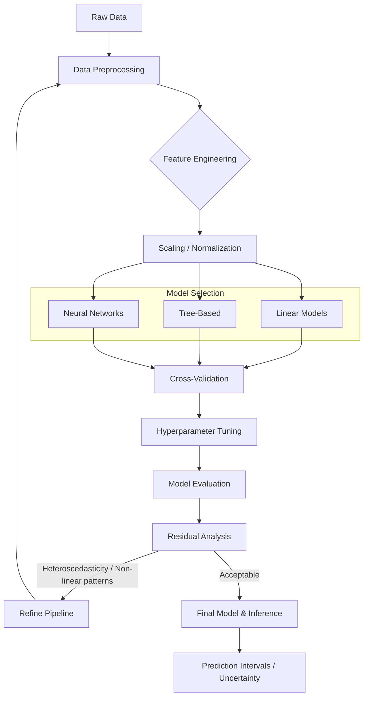

# MASTER ML/DL FIELD MANUAL & DECISION MAP

> **A decision-oriented engineering reference for the complete ML/DL lifecycle.**
> Enter at any stage. Find your current problem. Follow the decision tree. Move to the next stage.
>
> This is not a textbook — it is a field manual. Every section answers: *What am I deciding? What are my options? How do I choose? What can go wrong? How do I detect and fix it?*

---

## HOW TO USE THIS DOCUMENT

- **Don't read linearly.** Search for your current problem ("missing values", "overfitting", "CUDA OOM", "VLM hallucination") and jump in.
- **Every stage answers:** What happens here → What are my options → When do I pick each → What assumptions does each make → What can go wrong → How do I detect failure → What's the fallback → What comes next.
- **Tables** give ranges and starting points where a genuine convention exists. Where none exists, it says so explicitly instead of inventing false precision.
- **Decision trees** are conditional, not prescriptive. Context determines the right choice.
- **Cross-references** link related sections — decisions at one stage affect later stages.

---

# PART 0 — MASTER MAP: PROBLEM FAMILY OVERVIEW

Every ML/DL project is a walk down this tree. The **backbone stages are shared**; what changes per family is representation, model class, loss, and evaluation.

```text
WHAT AM I BUILDING?
│
├── TABULAR / STRUCTURED DATA
│   ├── TARGET IS CONTINUOUS
│   │   └── Regression (Part 12–13)
│   ├── TARGET IS CATEGORICAL
│   │   ├── 2 Classes → Binary Classification (Part 14–15)
│   │   ├── >2 Mutually Exclusive → Multiclass Classification (Part 14–15)
│   │   ├── >2 Non-Exclusive → Multilabel Classification (Part 14–15)
│   │   └── Ordered Categories → Ordinal Classification (Part 14)
│   ├── NO TARGET (DISCOVERY)
│   │   ├── Grouping → Clustering (Part 16)
│   │   ├── Compression/Visualization → Dimensionality Reduction (Part 16)
│   │   └── Outlier/Rare-Event Hunt → Anomaly Detection (Part 16)
│   └── MODEL FAMILY CHOICE
│       ├── Classical Supervised ML (Trees, Boosting, Linear) → Part 11
│       └── Neural-Network Tabular Learning (MLP, TabNet, FT-Transformer) → Part 17
│
├── IMAGE / SPATIAL DATA (Computer Vision)
│   ├── What is in this image? → Image Classification (Part 20–21)
│   ├── Where are the objects? → Object Detection (Part 20)
│   ├── Which pixels belong to what? → Image Segmentation (Part 20)
│   ├── What text is in this image? → OCR Pipeline (Part 29)
│   └── What does this image mean? → VLM / Visual Reasoning (Part 29)
│
├── SEQUENCE / TEMPORAL DATA
│   ├── Short/Medium, Limited Compute → RNN/LSTM/GRU (Part 24)
│   ├── Long Context, Parallelizable → Transformer (Part 25–26)
│   └── Time Series Forecasting → Temporal Models (Part 9, 24)
│
├── TEXT / LANGUAGE (NLP)
│   ├── Discriminative (Classification, NER, Extractive QA) → Part 25–26
│   └── Generative (LLM Training/Fine-Tuning, Chat) → Part 26–27
│
├── MULTIPLE MODALITIES (Multimodal Learning)
│   ├── Aligning Spaces → CLIP-Style Contrastive (Part 28)
│   ├── Generative/Reasoning → VLM Training/Fine-Tuning (Part 29)
│   └── Retrieval → Dual Encoder + Index (Part 28)
│
└── TRAINING & OPTIMIZATION STRATEGIES
    ├── No Labels? → Self-Supervised Learning (Part 26)
    ├── Starting from Scratch? → Pretraining (Part 27)
    ├── Have Existing Weights? → Transfer Learning (Part 23)
    └── Adapting Existing Weights? → Fine-Tuning (Full or PEFT) (Part 27)
```

## What Is Shared Across ALL Problem Families

```text
DATA → UNDERSTAND → VALIDATE → CLEAN → REFORM → TRANSFORM → REPRESENT →
SPLIT → AUGMENT → BASELINE → MODEL → LOSS → OPTIMIZE → TRAIN → VALIDATE →
HPO → ERROR ANALYSIS → ITERATE → FINAL TEST → EXPORT → INFER → MONITOR
```

This skeleton is universal. Every family is this skeleton with modality-specific substitutions at "represent" and family-specific substitutions at "model/loss/evaluate."

## What Differs, Explicitly

| Dimension                      | Varies By                                                                                                                                                 |
| ------------------------------ | --------------------------------------------------------------------------------------------------------------------------------------------------------- |
| **Representation**       | Modality (tabular encoding vs tokenization vs pixel tensor vs audio spectrogram)                                                                          |
| **Model family**         | Problem type (tree ensembles for tabular, CNN/ViT for images, Transformer for text/sequence)                                                              |
| **Loss**                 | Task (MSE for regression, cross-entropy for classification, contrastive for multimodal)                                                                   |
| **Evaluation metric**    | Task + business cost of each error type                                                                                                                   |
| **Before training**      | Augmentation, tokenization, feature engineering — modality-specific                                                                                      |
| **Inside training loop** | Forward/backward/optimizer step — identical shape across all NN families; classical ML has no explicit loop (fit is closed-form or internally iterative) |
| **After training**       | Calibration, thresholding, export format — task-specific                                                                                                 |
| **Inference-only**       | KV-cache, batching strategy, quantization — mostly relevant to NN/LLM/VLM                                                                                |

## Mutually Exclusive Choices (Pick One Path)

- Full fine-tuning **vs** LoRA/QLoRA/adapters (you don't do both on the same weights simultaneously)
- Freeze-then-fine-tune **vs** train-from-scratch (mutually exclusive strategies for the same backbone)
- Oversampling **vs** class-weighting as your *primary* imbalance fix (can combine cautiously, but pick a primary)
- One-hot encoding **vs** target/frequency encoding for the same high-cardinality categorical column

## Pipeline Component Lifecycle

| Component Type                 | Shared                                                       | Modality-Specific                                                       | Optional                                 |
| ------------------------------ | ------------------------------------------------------------ | ----------------------------------------------------------------------- | ---------------------------------------- |
| **Before Training**      | Data splitting, batching, defining loss/optimizer            | Tokenization (Text), Augmentation (Images/Audio), Scaling (Tabular)     | Dimensionality reduction, synthetic data |
| **Inside Training Loop** | Forward pass, loss, backward pass, optimizer step, zero_grad | Teacher forcing (RNNs), Contrastive pairs (CLIP), Gradient accumulation | Gradient clipping, Mixed precision, EMA  |
| **After Training**       | Validation metric, Checkpointing                             | NMS (Detection), Generation decoding (LLMs)                             | Error analysis, Distillation, Pruning    |
| **Inference Only**       | Forward pass, post-processing                                | KV Caching (LLMs), Dynamic batching                                     | TensorRT/ONNX export, Quantization       |

---

# PART 1 — THE UNIVERSAL ML LIFECYCLE

```text
RAW DATA
   ↓
DATA UNDERSTANDING        (inspect, profile — don't modify yet)
   ↓
DATA VALIDATION           (schema, ranges, types, constraints)
   ↓
DATA CLEANING             (missing values, duplicates, invalid entries, outliers)
   ↓
DATA REFORMATION          (reshaping, type casting, entity alignment, temporal alignment)
   ↓
DATA TRANSFORMATION       (scaling, log transforms, power transforms, tokenization)
   ↓
FEATURE / LABEL PROCESSING(feature engineering, encoding, label representation)
   ↓
SPLITTING                 (train/val/test — BEFORE fitting any statistics)
   ↓
AUGMENTATION              (train split ONLY, if used)
   ↓
BASELINE                  (simplest possible model — sets the floor)
   ↓
MODEL SELECTION & INITIALIZATION
   ↓
OBJECTIVE / LOSS
   ↓
OPTIMIZATION              (algorithm choice: Adam, SGD, etc.)
   ↓
TRAINING                  (iterative loop)
   ↓
VALIDATION                (periodic evaluation, no gradient updates)
   ↓
HYPERPARAMETER OPTIMIZATION    ← loops back to TRAINING
   ↓
ERROR ANALYSIS & ITERATION     ← loops back to any earlier stage
   ↓
FINAL TEST                (touched exactly ONCE)
   ↓
MODEL SELECTION (final)
   ↓
UNCERTAINTY / CALIBRATION / ROBUSTNESS CHECKS
   ↓
CHECKPOINT / EXPORT
   ↓
INFERENCE OPTIMIZATION
   ↓
DEPLOYMENT
   ↓
MONITORING                ← feeds back into RAW DATA for the next cycle
```

**Critical property:** Everything above "FINAL TEST" can be repeated as many times as needed. The test set is touched once — the moment you tune anything based on test performance, it silently becomes a second validation set and your final number is no longer a trustworthy estimate of generalization.

## Stage-by-Stage Decision Template

Every stage in this document follows this shape:

> **Stage** → **What happens here** → **Available techniques** → **When to use each** → **Assumptions** → **Alternatives** → **Trade-offs** → **Typical values/ranges** → **Common mistakes** → **Failure cases** → **How to detect failure** → **What comes next**

## How Decisions Propagate Across Stages

Decisions are not independent. Key interactions:

| Early Decision        | Downstream Effect                                                                |
| --------------------- | -------------------------------------------------------------------------------- |
| Imputation method     | Affects feature distributions → affects model choice and evaluation             |
| Split strategy        | Determines what "generalization" means → affects all metrics                    |
| Feature scaling       | Required by some models, irrelevant to others → affects model selection         |
| Label representation  | Determines loss function → determines output layer → determines metric         |
| Augmentation choices  | Change effective training distribution → can affect calibration                 |
| Batch size            | Affects gradient noise, BatchNorm statistics, learning rate scaling              |
| Precision (FP16/BF16) | Affects numerical stability → may require GradScaler → affects reproducibility |

---

# PART 2 — DATA UNDERSTANDING PIPELINE

**Goal at this stage: look, don't modify.** Every decision downstream depends on what you find here.

## 2.1 — Structural Inspection

```python
import pandas as pd
import numpy as np

# Shape and structure
print(f"Shape: {df.shape}")       # (rows, columns)
display(df.head(10))               # Sanity check actual values
display(df.sample(10))             # Random sample — catches sorted/grouped data

# Inferred types — verify, don't trust
print(df.dtypes)
print(df.info(memory_usage='deep'))
```

**Why `df.sample()` matters:** If data is sorted by target or grouped by entity, `df.head()` gives a misleading picture.

## 2.2 — Per-Column Type Audit

Classify every column into one of: **numerical (continuous/discrete), categorical (nominal/ordinal), binary, datetime, text, image path, audio path, ID/leakage-risk.**

```python
# Cardinality — flags IDs (nunique ≈ len(df)) and near-constants (nunique ≤ 1)
print(df.nunique().sort_values())

# Numerical summary
print(df.describe())               # range, mean, std, quartiles → spot impossible values

# Categorical summary
print(df.describe(include='object'))  # top category, frequency

# Check for columns that LOOK numerical but are actually categorical
# (e.g., zip codes stored as integers, binary flags as 0/1 float)
for col in df.select_dtypes(include=np.number).columns:
    n_unique = df[col].nunique()
    if n_unique < 20:
        print(f"  {col}: only {n_unique} unique values — possibly categorical?")
```

## 2.3 — Missingness and Quality

```python
# Missing values
missing = df.isna().mean().sort_values(ascending=False)
print(missing[missing > 0])        # Only show columns with missing data

# Exact duplicate rows
n_dupes = df.duplicated().sum()
print(f"Exact duplicate rows: {n_dupes} ({n_dupes/len(df)*100:.1f}%)")

# Entity duplicates (if you have a business key)
if 'user_id' in df.columns:
    entity_dupes = df.duplicated(subset=['user_id']).sum()
    print(f"Duplicate user_id entries: {entity_dupes}")
```

## 2.4 — Target Inspection (Do This Before Touching Features)

```python
target = 'your_target_column'

print(f"Target dtype: {df[target].dtype}")
print(f"Target missing: {df[target].isna().sum()}")

# Classification: class balance
if df[target].nunique() < 50:
    print(df[target].value_counts(normalize=True))

# Regression: distribution shape
else:
    print(df[target].describe())
    df[target].hist(bins=50)  # shape → informs log-transform decision
```

**Why inspect the target first:** If the target has missing values, impossible values, severe imbalance, or extreme skew, this changes every downstream decision (imputation strategy, loss function, metric, split strategy).

## 2.5 — Consistency Checks

- **Inconsistent formatting:** `"NY"` vs `"New York"` vs `"ny"` — normalize casing/whitespace before treating as categorical.
- **Impossible values:** Negative ages, dates in the future, percentages > 100, prices of 0 for items that should have a price.
- **Corrupted samples:** All-zero images, empty text fields, truncated audio files.
- **Mixed types in one column:** A column with both numbers and strings (e.g., `"N/A"` mixed with numeric values).
- **Encoding issues:** Unicode errors, mojibake, mixed character encodings.

## 2.6 — Distribution Analysis

```python
# Correlation analysis (numerical features)
corr_matrix = df[num_cols].corr()
# Look for:
#   - Features highly correlated with each other (>0.95) → possible redundancy
#   - Features highly correlated with target (>0.95) → possible leakage
#   - Features with zero correlation to target → may be uninformative (but check for nonlinear relationships)

# Train/test distribution differences (if splits are pre-defined)
# Compare feature distributions between splits — a large shift signals
# leakage risk or a need for domain adaptation
```

## 2.7 — Leakage Scan (Early, Cheap Check)

Ask of every column: **"Would this value be available at prediction time, in production, before the target is known?"**

If no → drop or lag it now, before it contaminates anything downstream.

```text
LEAKAGE RED FLAGS:
│
├── Feature has near-perfect correlation with target (>0.95)
│   → Almost certainly target leakage. Investigate before proceeding.
│
├── Feature is conceptually measured AFTER the target event
│   → Temporal leakage (e.g., "cancellation_date" when predicting churn)
│
├── Feature is derived FROM the target
│   → Direct leakage (e.g., "has_tumor_treatment" when predicting tumor)
│
├── Column is a unique ID or near-unique identifier
│   → Entity leakage risk if not handled in splitting
│
└── Feature contains future information
    → Temporal leakage in time-series data
```

> [!WARNING]
> A high correlation with the target does NOT automatically mean leakage — it could be a genuinely strong predictor. The question is whether the feature would be *available at prediction time in production*. A feature that perfectly predicts the target but is only knowable after the target event is useless and dangerous.

**What comes next:** Data Validation (Part 3) if structural issues were found; Data Cleaning (Part 4) for quality issues; or straight to Splitting (Part 9) if data is already clean.

---

# PART 3 — DATA VALIDATION

## 3.1 — Why Validate Before Cleaning?

Validation asserts that data meets expectations *before* any modification. Without it, downstream failures (NaN from log-transforming negative values, crashes from unexpected types) are discovered too late and are harder to debug.

## 3.2 — Data Quality Dimensions

| Dimension              | What to Check                                           | Example                                        |
| ---------------------- | ------------------------------------------------------- | ---------------------------------------------- |
| **Completeness** | Missing values, empty strings, null markers             | `"N/A"`, `""`, `NaN`, `-999`           |
| **Consistency**  | Same entity described differently                       | `"USA"` vs `"US"` vs `"United States"`   |
| **Accuracy**     | Values that are syntactically valid but factually wrong | Age = 200, Temperature = -500°C               |
| **Timeliness**   | Data freshness relative to the task                     | Training on 2019 data to predict 2024 behavior |
| **Uniqueness**   | Unwanted duplicates                                     | Same transaction recorded twice                |
| **Validity**     | Values within allowed domain                            | Negative prices, probabilities > 1             |

## 3.3 — Schema Validation

```python
# Define expected schema
expected_schema = {
    'age': {'dtype': 'numeric', 'min': 0, 'max': 150, 'nullable': False},
    'income': {'dtype': 'numeric', 'min': 0, 'nullable': True},
    'city': {'dtype': 'string', 'nullable': True},
    'signup_date': {'dtype': 'datetime', 'max': 'today', 'nullable': False},
}

# Validate (conceptual — use Pydantic, Great Expectations, or custom asserts)
for col, rules in expected_schema.items():
    assert col in df.columns, f"Missing column: {col}"
    if rules.get('min') is not None:
        violations = (df[col] < rules['min']).sum()
        if violations > 0:
            print(f"WARNING: {col} has {violations} values below {rules['min']}")
```

**Tools:** Pydantic (row-level validation), Great Expectations (dataset-level expectations), pandera (DataFrame schema validation), or simple assertions for smaller projects.

## 3.4 — Value-Range Validation

```text
FOR EACH COLUMN:
│
├── Numerical:
│   ├── Check min/max against domain knowledge
│   ├── Check for sentinel values (-999, 9999, etc.)
│   ├── Check for infinity values
│   └── Check for values that should be positive but aren't
│
├── Categorical:
│   ├── Check for unexpected categories
│   ├── Check for whitespace variants of the same category
│   └── Check for encoding issues (mojibake)
│
├── Datetime:
│   ├── Check for dates in the future (if not expected)
│   ├── Check for dates before reasonable minimum
│   └── Check for timezone consistency
│
└── Text:
    ├── Check for empty strings vs null
    ├── Check for HTML/markup contamination
    └── Check for encoding issues
```

## 3.5 — Cross-Field Validation

Some constraints involve multiple columns:

- `start_date` must be before `end_date`
- `age` should be consistent with `birth_date`
- `total` should approximately equal `quantity * unit_price`
- If `status = "completed"`, then `completion_date` should not be null

**What comes next:** Data Cleaning (Part 4) to address issues found during validation.

---

# PART 4 — DATA CLEANING

## 4.1 — Missing Values — Full Decision System

### Missing Feature vs Missing Target — Treat These Completely Differently

A missing **feature** value is a data-quality problem you impute or flag. A missing **target** value means you don't have a supervised training example — this is a fundamentally different situation because you cannot compute a supervised loss without a target.

### Missingness Types — What They Mean and Why They Matter

| Type                                          | Definition                                                            | Example                                                      | Implication                                                   |
| --------------------------------------------- | --------------------------------------------------------------------- | ------------------------------------------------------------ | ------------------------------------------------------------- |
| **MCAR** (Missing Completely At Random) | Missingness is independent of both observed and unobserved data       | Lab equipment randomly fails                                 | Safe to drop rows (no bias), though you lose data             |
| **MAR** (Missing At Random)             | Missingness depends on observed data but not the missing value itself | Younger patients less likely to have blood pressure recorded | Imputation using observed features can be unbiased            |
| **MNAR** (Missing Not At Random)        | Missingness depends on the missing value itself                       | High-income individuals refuse to report income              | Imputation is biased — the missingness itself is informative |

> [!IMPORTANT]
> **You cannot definitively determine missingness type from the data alone.** MCAR vs MAR vs MNAR is partly a domain knowledge judgment. Statistical tests (e.g., Little's MCAR test) can provide evidence against MCAR but cannot prove MAR vs MNAR. Do not claim certainty about the missingness mechanism from a single correlation test.

### A. Missing FEATURE — Numerical

```text
MISSING NUMERICAL FEATURE
│
├── What % is missing?
│   ├── < 5%, appears random (MCAR-looking)
│   │   ├── Mean imputation: if distribution is roughly symmetric, no severe outliers
│   │   ├── Median imputation: if distribution is skewed or has outliers
│   │   └── Drop rows: if dataset is large and losing a few rows is negligible
│   │
│   ├── 5–40% missing
│   │   ├── Does missingness correlate with other features or the target?
│   │   │   ├── YES → Add a missing-indicator column (missingness itself may be signal)
│   │   │   │         PLUS impute the value using one of the methods below
│   │   │   └── NO → Impute without indicator
│   │   │
│   │   ├── Is there a natural grouping?
│   │   │   └── YES → Group-wise mean/median (e.g., fill missing salary by job_title median)
│   │   │
│   │   ├── Are features correlated?
│   │   │   ├── YES, moderate dataset → KNN imputation
│   │   │   └── YES, complex patterns → Iterative imputation (MICE-style)
│   │   │
│   │   └── Is data ordered/temporal?
│   │       └── YES → Forward-fill / backward-fill / interpolation
│   │
│   └── > 40–50% missing
│       ├── Is the feature critical (strong domain knowledge)?
│       │   ├── YES → Model-based imputation + missing indicator
│       │   └── NO → Consider dropping the feature entirely
│       └── Keep only the missing indicator (the fact that it's missing IS the signal)
│
└── Using a model that handles missing values natively?
    (XGBoost, LightGBM, CatBoost can learn splits around missingness)
    → Leave as-is, let the model handle it
    → Still consider adding a missing indicator if missingness is informative
```

| Method                           | When                                                        | Trade-off                                                        |
| -------------------------------- | ----------------------------------------------------------- | ---------------------------------------------------------------- |
| Drop rows                        | Missing is rare and plausibly MCAR                          | Loses data, can bias if not MCAR                                 |
| Mean/median                      | Quick baseline, roughly symmetric/skewed respectively       | Ignores relationships between features, reduces variance         |
| Constant (0, -999)               | Missingness is meaningful and model can learn a split on it | Can distort scale-sensitive models unless flagged separately     |
| Forward/backward fill            | Ordered/time-series data                                    | Wrong if the sequence isn't continuous or has large gaps         |
| Group-wise mean/median           | Clear natural grouping exists                               | Breaks down for tiny groups (few observations per group)         |
| KNN imputation                   | Moderate size data, features are correlated                 | Expensive at scale, sensitive to feature scaling                 |
| Iterative/MICE imputation        | Complex missingness patterns, enough data                   | Slow, risk of overfitting the imputation model itself            |
| Missing-indicator feature        | Missingness correlates with target                          | Doubles feature count if applied everywhere — apply selectively |
| Native handling (tree ensembles) | Using XGBoost/LightGBM/CatBoost                             | Not available in linear models, SVM, most NN architectures       |

> [!WARNING]
> **Do NOT use fixed percentage thresholds as hard rules.** "Drop if > 30% missing" is a heuristic, not a law. The right decision depends on: (1) how informative the feature is, (2) why it's missing, (3) what model you're using, (4) how much data you have overall. A feature with 60% missing that is strongly predictive when present may be worth keeping with a missing indicator.

### B. Missing FEATURE — Categorical

```text
MISSING CATEGORICAL FEATURE
│
├── Missing is rare (< 5%), one category dominates → Mode imputation
│
├── "Missing" might be a real signal
│   (e.g., field only filled for premium users, or opt-in survey question)
│   → Treat as its own explicit category ("Unknown" / "Missing")
│     This preserves the information that the value was not provided
│
├── Natural grouping exists → Group-wise mode
│   (e.g., missing 'City' filled by mode of 'State')
│
└── Complex dependency on other features → Predictive imputation
    (train a small classifier to predict the missing category)
```

**Prefer explicit "Unknown" category over mode imputation whenever missingness could be non-random** — mode imputation silently destroys the signal that the value was not provided.

### C. Missing TARGET — This Is NOT the Same Problem

**Why:** You cannot compute a supervised loss without a target. Blindly filling it (e.g., with the mean) fabricates a label and trains the model on a lie you invented; this is qualitatively different from filling an input feature, where the model still has a real target to learn against.

```text
TARGET HAS MISSING / "?" VALUES
         ↓
What does the missing value actually mean? (Check data source / documentation)
         ↓
    ┌────────────┬──────────────────┬────────────────────┬─────────────────┐
    │            │                  │                    │                 │
 Truly         A real             Censored/            Not yet
 unknown/      category           truncated            measured
 unmeasured   ("did not           (e.g., "income       (will arrive
               disclose")          > $200k" as "?")     later)
    │            │                  │                    │
    ↓            ↓                  ↓                    ↓
 See below     Keep as its        Model as censored    This is a
               own class if       data (survival       streaming/
               classification     analysis, or         forecasting
                                  bucket into top      problem, not
                                  open-ended bin)      a missing-
                                                       value problem
```

**Once confirmed genuinely missing:**

```text
GENUINELY MISSING TARGET
│
├── Small % missing, plenty of labeled data remains
│   → Remove rows (safe default when the loss is negligible)
│
├── Large % missing, unlabeled rows have useful features
│   ├── Semi-supervised learning: train on labeled subset,
│   │   pseudo-label the unlabeled subset with high-confidence predictions,
│   │   retrain (verify confidence before trusting pseudo-labels)
│   ├── Self-supervised pretraining on ALL data (ignoring labels),
│   │   then fine-tune on the labeled subset
│   └── Only worth the complexity when labeled data alone is
│       provably insufficient
│
└── Missingness is NOT random (e.g., only failures never got labeled)
    → This is a labeling-process bias, not a missing-data problem
    → Fixing it requires addressing the collection process, not imputation
```

## 4.2 — Duplicates

```text
DUPLICATES DETECTED
│
├── EXACT row duplicates
│   ├── Are they data collection artifacts? (same record ingested twice)
│   │   └── YES → Remove duplicates, keep one copy
│   └── Are they legitimate? (same transaction happening twice is valid)
│       └── YES → Keep them
│
├── ENTITY duplicates (same entity, different rows)
│   ├── Same patient with multiple visits → These are GROUPED observations
│   │   → Do NOT remove — handle via grouped splitting (Part 9)
│   ├── Same entity with CONFLICTING values → Data quality issue
│   │   → Investigate: which record is correct? Use most recent? Average?
│   └── Same entity, same values → True duplicates, remove extras
│
└── NEAR-duplicates (very similar but not identical)
    ├── In tabular data: records that differ only in noise/rounding
    ├── In text data: paraphrases or minor edits
    ├── In image data: same image with slight crops/compressions
    └── Detection: hashing, embedding similarity, MinHash/LSH
        → Critical to handle BEFORE splitting to prevent train/test contamination
```

## 4.3 — Invalid and Inconsistent Values

| Issue                        | Detection                              | Resolution                                         |
| ---------------------------- | -------------------------------------- | -------------------------------------------------- |
| Impossible values (age = -5) | Domain-knowledge assertions            | Fix if source is known; otherwise treat as missing |
| Sentinel values (-999, 9999) | Check for suspicious constants         | Map to NaN, then handle as missing                 |
| Mixed types in column        | `df[col].apply(type).value_counts()` | Parse or coerce; investigate unparseable values    |
| Inconsistent formatting      | String normalization                   | Standardize case, whitespace, encoding             |
| Unit inconsistencies         | Domain knowledge                       | Convert to common unit; document the conversion    |

## 4.4 — Outliers — Full Decision System

```text
OUTLIERS DETECTED (e.g., Age = 200, or Salary = $50M)
│
├── Is it a DATA ERROR? (Age = 200, physically impossible)
│   └── YES → Fix if correct value is known; otherwise treat as missing
│
└── Is it a LEGITIMATE rare observation? (Salary = $50M for a CEO)
    │
    ├── Is it in the TARGET (what you're predicting)?
    │   ├── Using a scale-sensitive loss (MSE)?
    │   │   → Consider: log-transform the target, or use Huber loss
    │   │     to prevent the outlier from dominating gradients
    │   └── Using a robust loss (MAE, Huber)?
    │       → May be fine as-is
    │
    └── Is it in an INPUT FEATURE?
        │
        ├── Tree-based model?
        │   → Generally robust — trees split by rank, not magnitude
        │     Do nothing unless the outlier is an error
        │
        ├── Linear model / SVM / KNN / NN?
        │   ├── RobustScaler (uses median/IQR instead of mean/std)
        │   ├── Winsorize (cap at e.g., 1st/99th percentile)
        │   ├── Log transform (if values are positive and right-skewed)
        │   └── Clip to known physical bounds
        │
        └── Is the outlier the SIGNAL you're trying to detect?
            (e.g., fraud detection, rare disease)
            → DO NOT REMOVE — removing it removes the signal
            → Consider anomaly detection methods instead
```

**Model-specific sensitivity to outliers:**

| Model Type                 | Outlier Sensitivity          | Why                                                       |
| -------------------------- | ---------------------------- | --------------------------------------------------------- |
| Linear models              | High                         | Outliers exert high leverage on the fitted line/plane     |
| KNN                        | High                         | Distance calculations are dominated by outlier dimensions |
| SVM                        | High                         | Support vectors can be pulled by outliers                 |
| Neural Networks (MSE loss) | High                         | Large values produce large gradients                      |
| Decision Trees             | Low for features             | Splits based on order, not magnitude                      |
| Random Forest / Boosting   | Low for features             | Ensemble of trees, each robust to feature outliers        |
| All regression models      | Moderate for target outliers | Even trees can be distorted by extreme target values      |

> [!TIP]
> **Do not treat all outlier detection methods as equally valid.** Z-score assumes normality; IQR is more robust but still assumes a roughly symmetric distribution. For heavily skewed data, both can flag legitimate values as outliers. Domain knowledge is the most reliable outlier detector.

**What comes next:** Data Reformation (Part 5) to reshape and align the cleaned data.

---

# PART 5 — DATA REFORMATION & TRANSFORMATION

## 5.1 — Data Reformation

Reformation changes the **structure** of data without changing its meaning:

| Operation              | When                                   | Example                                                          |
| ---------------------- | -------------------------------------- | ---------------------------------------------------------------- |
| Reshaping (pivot/melt) | Data is in wrong layout for modeling   | Transactions → user-level features                              |
| Aggregation            | Multiple rows per entity need summary  | Daily sales → weekly totals                                     |
| JSON/nested unnesting  | Structured fields need flattening      | `{"address": {"city": "NY"}}` → separate columns              |
| Date parsing           | Dates stored as strings                | `"2024-01-15"` → datetime → extract year, month, day_of_week |
| Entity alignment       | Multiple data sources need joining     | Join customer table with transaction table                       |
| Temporal alignment     | Time series at different granularities | Hourly sensors + daily labels → align to common frequency       |
| Text normalization     | Inconsistent text formatting           | Lowercase, strip whitespace, normalize unicode                   |

## 5.2 — Numerical Transformations

| Technique                           | Formula/Idea                                            | When Useful                                                                     | When NOT Needed                                                           | Outlier Sensitivity                    |
| ----------------------------------- | ------------------------------------------------------- | ------------------------------------------------------------------------------- | ------------------------------------------------------------------------- | -------------------------------------- |
| **Standardization (z-score)** | $(x - \mu) / \sigma$                                  | Linear models, SVM, KNN, PCA, NNs — anything distance/gradient-scale sensitive | Tree-based models (splits are scale-invariant)                            | Sensitive — outliers distort mean/std |
| **Min-Max Scaling**           | $(x - \min) / (\max - \min)$                          | Bounded-input needs (NN inputs into sigmoid), image pixels                      | Tree models; when outliers exist (single extreme compresses everything)   | Very sensitive                         |
| **Robust Scaling**            | $(x - \text{median}) / \text{IQR}$                    | Data with outliers you want to keep but not let dominate scale                  | Clean, roughly Gaussian data (no benefit over z-score)                    | Robust by design                       |
| **Log Transform**             | $\log(x)$ or $\log(1+x)$                            | Right-skewed positive data (income, counts, prices)                             | Already symmetric data, or data with negatives/zeros (use log1p for ≥ 0) | Reduces influence of large values      |
| **Box-Cox**                   | Learned power parameter$\lambda$ to approach Gaussian | Need near-normal residuals for linear model assumptions                         | Trees/NNs that don't assume normality                                     | Requires strictly positive values      |
| **Yeo-Johnson**               | Extension of Box-Cox                                    | Same as Box-Cox but handles negative/zero values                                | Trees/NNs                                                                 | Handles zero/negative values           |
| **Clipping / Winsorization**  | Cap values at a percentile (e.g., 1st/99th)             | Extreme values are believable-but-rare, want to limit leverage                  | When extreme values are the signal (fraud, rare events)                   | Directly limits outlier influence      |

**Model-dependent scaling requirement:**

```text
REQUIRES SCALING:
  Linear/Logistic Regression, Ridge/Lasso/Elastic Net,
  SVM, KNN, PCA, Neural Networks

DOES NOT REQUIRE SCALING:
  Decision Trees, Random Forest, Gradient Boosting
  (XGBoost / LightGBM / CatBoost)
```

> [!TIP]
> Tree models (Random Forest, XGBoost, LightGBM, CatBoost) are invariant to monotonic transformations of features. Scaling numbers does not change how a decision tree splits them. Do not waste compute scaling features for tree-based models. However, if you're comparing tree and non-tree models in the same pipeline, scale consistently and let the tree model ignore it.

## 5.3 — Categorical Encoding Strategies

This is a critical decision point. The wrong encoding can fabricate relationships, leak information, or cause dimensionality explosion.

```text
CATEGORICAL FEATURE
         │
    What is the nature of the categories?
    │               │              │               │
 ORDINAL         BINARY     LOW CARDINALITY   HIGH CARDINALITY
(S/M/L,          (Y/N,       (< ~15-30          (> ~30 unique,
 Low/Med/High)   True/False)  unique values)     e.g., ZIP code,
    │               │              │              product ID)
    │               │              │               │
OrdinalEncoder   LabelEncoder   OneHotEncoder      │
(preserves       (0/1 is fine   (creates binary    ├── Tree Model?
 known order)     for binary)    columns per        │   → Target Encoding (with proper CV)
                                 category)          │   → Frequency Encoding
                                                    │   → Leave as integer codes (trees can
                                                    │     split arbitrarily)
                                                    └── Neural Net?
                                                        → Embedding Layer
                                                        → Hashing (if cardinality is
                                                          unbounded/streaming)
```

| Encoding                       | When                                                               | Danger                                                                                                                                                                  |
| ------------------------------ | ------------------------------------------------------------------ | ----------------------------------------------------------------------------------------------------------------------------------------------------------------------- |
| **Label encoding**       | Ordinal categories with genuine order, or raw input to tree models | **Implies false ordering for nominal categories** in linear models/NNs — `{Mumbai=0, Delhi=1, Chennai=2}` makes a linear model assume Chennai > Delhi > Mumbai |
| **Ordinal encoding**     | Explicit, known ranking (education level, sizes S/M/L)             | Wrong when categories are not truly ordered                                                                                                                             |
| **One-hot encoding**     | Low-cardinality nominal categories, linear/NN models               | Cardinality explosion above ~15-50 unique values; sparse, memory-heavy                                                                                                  |
| **Target encoding**      | High-cardinality nominal categories (zip code, user ID)            | **Leakage if not done with proper cross-fold/out-of-fold fitting**; must be fit on train only                                                                     |
| **Frequency encoding**   | High-cardinality, when frequency is informative                    | Collapses distinct categories with identical frequency into the same value                                                                                              |
| **Embeddings (learned)** | Very high cardinality inside a neural network                      | Needs enough data per category to learn meaningful vectors                                                                                                              |
| **Hashing**              | Very high/unbounded cardinality, streaming settings                | Hash collisions between unrelated categories are possible and untraceable                                                                                               |

> [!CAUTION]
> **NEVER use LabelEncoder for nominal variables if using a linear model, SVM, or NN.** If `Mumbai=0, Delhi=1, Chennai=2`, a linear model assumes Chennai is numerically "greater than" Delhi. This fabricates a relationship that doesn't exist. Use One-Hot Encoding or Target Encoding instead.

### Target Encoding — Done Correctly

Target encoding replaces a category with the mean of the target for that category. This is powerful but dangerous:

```text
TARGET ENCODING LEAKAGE:
│
├── WRONG: Compute target mean per category on the full training set,
│          then use that value for each row
│          → Each row's own target leaks into its encoded feature value
│
└── RIGHT: Use out-of-fold encoding within the training set
           → For each fold, compute target means from OTHER folds only
           → Each row's encoded value never sees its own target
           → Add smoothing (blend with global mean for rare categories)
```

```python
# Conceptual — proper target encoding with smoothing
# For each category c:
#   encoded(c) = (count(c) * mean_target(c) + m * global_mean) / (count(c) + m)
# where m is the smoothing parameter (higher m → more regularization toward global mean)
```

## 5.4 — Text Data Pipeline

```text
Raw Text
  │
Cleaning (lowercase, remove HTML, normalize unicode, handle special chars)
  │
Tokenization Strategy:
  ├── Word-level (split by space/punctuation)
  │   → Huge vocabulary, handles OOV poorly, simple
  ├── Subword (BPE, WordPiece, SentencePiece)
  │   → MODERN STANDARD — handles unseen words via subword fallback
  │   → Used by BERT, GPT, LLaMA, all modern models
  └── Character-level
      → Tiny vocabulary, very long sequences, slow training
  │
Vocabulary Construction (Fit on TRAIN text ONLY)
  │
Token → ID Mapping
  │
Padding (Pad to max length in BATCH, not global dataset max)
  │
Attention Masks (1 for real token, 0 for pad token)
  │
Embeddings (nn.Embedding or pretrained embeddings)
```

**Why subword tokenization dominates:** It balances vocabulary size against sequence length. Unknown words are decomposed into known subword units (e.g., "unhappiness" → "un", "happiness" or "un", "happi", "ness"), avoiding the out-of-vocabulary problem entirely.

## 5.5 — Image Data Pipeline

```text
Raw Image File
  │
Decode (PIL, cv2) → Validate channels (RGB vs BGR vs grayscale)
  │
Resize Strategy:
  ├── Aspect-agnostic resize (squishes image — fast but distorts)
  ├── Resize shortest edge + Center Crop (standard for evaluation)
  └── Resize shortest edge + Random Resized Crop (standard for training)
  │
Tensor Conversion
  HWC (Height, Width, Channels) → CHW (Channels, Height, Width) for PyTorch
  │
Normalization:
  (Pixel / 255.0) then subtract mean, divide by std
  • Use ImageNet stats (mean=[0.485, 0.456, 0.406], std=[0.229, 0.224, 0.225])
    if using a model pretrained on ImageNet
  • Compute mean/std on YOUR training set if training from scratch
  │
Augmentation (TRAINING ONLY — flips, color jitter, etc.) → Part 37
  │
Batch → [B, C, H, W]
```

## 5.6 — Feature Engineering

Feature engineering creates new informative features from existing data. It is often the single highest-leverage activity for tabular ML.

### Types of Engineered Features

| Type                               | Example                         | When Useful                                           |
| ---------------------------------- | ------------------------------- | ----------------------------------------------------- |
| **Polynomial / interaction** | $x_1 \cdot x_2$, $x_1^2$    | Known nonlinear relationships; use with linear models |
| **Ratios**                   | revenue / employees             | Business-meaningful ratios                            |
| **Aggregations**             | mean purchase per user          | Grouped/entity data                                   |
| **Temporal**                 | day_of_week, month, is_weekend  | Date/time features                                    |
| **Lag features**             | value at$t-1$, $t-7$        | Time series                                           |
| **Rolling statistics**       | 7-day rolling mean              | Time series smoothing                                 |
| **Domain-specific**          | BMI from height/weight          | Expert knowledge                                      |
| **Binning**                  | Age groups (0-18, 19-35, ...)   | When the relationship is step-like, not linear        |
| **Count encoding**           | Number of transactions per user | Entity-level aggregation                              |

> [!WARNING]
> **Feature engineering for time series must respect temporal ordering.** Rolling statistics and lag features must be computed using only *past* data relative to each row's timestamp. Computing a rolling mean that includes future values is temporal leakage.

## 5.7 — Feature Selection

```text
TOO MANY FEATURES?
│
├── Filter methods (fast, model-agnostic)
│   ├── Correlation with target (remove uncorrelated features)
│   ├── Variance threshold (remove near-constant features)
│   ├── Mutual information
│   └── Chi-squared test (categorical features vs categorical target)
│
├── Wrapper methods (expensive, model-specific)
│   ├── Recursive Feature Elimination (RFE)
│   ├── Forward/backward stepwise selection
│   └── Permutation importance
│
├── Embedded methods (built into model training)
│   ├── Lasso (L1 — drives coefficients to zero)
│   ├── Elastic Net
│   ├── Tree-based feature importance (Gini, permutation)
│   └── SHAP values
│
└── Dimensionality reduction (not exactly selection)
    ├── PCA (linear, unsupervised)
    ├── UMAP (nonlinear, can be supervised)
    └── Autoencoders (nonlinear, learned compression)
```

**When feature selection helps:** High-dimensional data with many uninformative features, overfitting on small datasets, reducing training/inference cost, improving interpretability.

**When to skip it:** Tree-based models handle irrelevant features reasonably well (they just don't split on them). Deep learning models can learn to ignore irrelevant inputs (though they may overfit to them on small data).

**What comes next:** Feature/Label Representation (Part 6) → Data Splitting (Part 9).

# PART 6 — FEATURE / LABEL REPRESENTATION

The bridge between raw data and mathematical optimization is representation. How you represent features (inputs) and labels (targets) directly determines the optimization landscape. Poor representation guarantees poor learning, regardless of model sophistication.

## 6.1 Feature Design Principles

Features must map domain concepts into computable numeric vectors while adhering to three core principles.

1. **Informativeness**: The feature must contain signal related to the target. Noise injection only complicates the loss surface. Does the feature distinguish between different target states? If not, discard it.
2. **Computability at Inference Time**: A feature is useless if it cannot be computed when the model is deployed. If a feature relies on data that arrives *after* the prediction must be made, it violates causal boundaries.
3. **Absence of Leakage**: Leakage occurs when a feature inadvertently contains information about the target that will not be available in a true inference scenario. (e.g., using "surgery_end_time" to predict "surgery_duration").

### Feature Types and Transformations

* **Continuous Numeric**: Often require scaling (Standardization, Min-Max, Robust Scaling) for distance-based models (SVM, KNN) or gradient-based models (Neural Networks, Linear/Logistic Regression). Tree-based models are typically invariant to monotonic transformations.
* **Skewed Numeric**: Heavy-tailed distributions (e.g., income, user clicks) often benefit from log-transforms ($x' = \log(x+1)$) or Box-Cox/Yeo-Johnson transformations to stabilize variance and normalize the distribution.
* **Categorical**:
  * *Low Cardinality*: One-hot encoding.
  * *High Cardinality*: Target encoding, embeddings, or hashing. Target encoding must be done with extreme care (e.g., using cross-validation or smoothing) to prevent target leakage.
* **Ordinal**: Integer encoding preserving the order (e.g., Low=1, Medium=2, High=3). Be aware that standard linear models will assume equal distance between these integer steps; if this assumption fails, treat them as categorical or use splines.

## 6.2 Label Representation

How the model understands its goal is governed by label representation.

### Regression Targets

* **Continuous**: Direct prediction of a real number. Scale target variables (e.g., mean 0, variance 1) for neural networks to ensure stable gradient flow and avoid exploding loss.
* **Log-Transformed**: Used when the target spans multiple orders of magnitude or has a strict lower bound (e.g., predicting prices or counts). *Failure Mode*: Forgetting to apply the inverse transform ($e^y - 1$) at inference time.
* **Binned (Classification Proxy)**: Converting a continuous target into discrete bins (e.g., predicting age ranges instead of exact age). Useful when exact precision is unnecessary and the task is highly noisy.

### Classification Targets

* **Integer Encoded**: Used commonly in PyTorch's `CrossEntropyLoss`, where targets are class indices (0 to C-1).
* **One-Hot Encoded**: A vector of length $C$ with a single 1 and $C-1$ zeros. Often used conceptually, or when targets are soft probabilities (e.g., distillation).
* **Multi-Hot Encoded**: For multi-label classification. A vector where multiple bits can be 1 simultaneously. Requires `BCEWithLogitsLoss`.

### Ordinal Targets

When classes have an inherent order but varying intervals (e.g., disease severity stages I, II, III, IV), neither standard classification nor regression is perfectly appropriate.

* *Approach*: Formulate as multiple binary classification tasks (e.g., "Is severity > I?", "Is severity > II?").

## 6.3 Multi-Output Design

* **Multi-Target Regression**: Predicting multiple continuous values simultaneously (e.g., predicting x, y, z coordinates). Models like Neural Networks or Random Forests natively support this. Linear models usually fit independent weights for each target unless regularized jointly.
* **Multi-Label Classification**: Predicting multiple binary tags for a single instance.
  * *Decision*: Do the labels exhibit strong correlation? If yes, joint modeling (e.g., shared neural network layers) often outperforms training $N$ independent binary classifiers, as the model learns to exploit label dependencies.

---

# PART 7 — DATA SPLITTING

Data splitting is the foundation of generalization estimation. A flawed split produces a compromised validation metric, leading to catastrophic deployment failures.

## 7.1 The Tripartite Split (Train / Val / Test)

Why three sets?

1. **Train**: Used exclusively to optimize model parameters (weights, biases, tree splits).
2. **Validation**: Used to evaluate the model during development to tune *hyperparameters*, select features, and make architectural decisions. It provides an unbiased estimate of performance *relative to the training set*, but becomes biased over time as you iteratively select the best model based on its score.
3. **Test (Holdout)**: Used *exactly once* at the end of the project to provide a final, unbiased estimate of generalization performance. If you make model changes based on the test set, it becomes a second validation set.

*Important Note on Ratios*: Do NOT blindly use 70/15/15 or 80/10/10.

* With 1 million samples, a 98/1/1 split provides 10,000 validation/test samples—usually plenty for statistical significance.
* With 500 samples, an 80/10/10 split leaves only 50 test samples, making evaluation highly noisy. In low-data regimes, favor Cross-Validation.

## 7.2 Split Strategies

Choosing how to assign samples to sets is more critical than the ratio.

### 1. IID Random Split

Samples are assigned randomly.

* **When to use**: Data points are truly independent and identically distributed. (Rare in complex, real-world data).
* **When NOT to use**: Time series, grouped data, highly imbalanced classification.

### 2. Stratified Split

Ensures the class distribution (or continuous target distribution) remains consistent across all splits.

* **When to use**: Classification tasks, especially imbalanced ones. Prevents splits that lack minority class representations.

### 3. Grouped / Entity-Disjoint Split

Ensures that all records belonging to a specific "group" or "entity" end up in the *same* split.

* **The Leakage Threat**: If patient A has 5 X-rays, and 3 go to train and 2 go to validation, the model might learn to recognize patient A's collarbone structure rather than the disease.
* **When to use**: Medical data (group by patient), customer behavior (group by user ID), multiple sensors on the same machine (group by machine ID).

### 4. Temporal Split (Out-of-Time)

Splits based on a timestamp. e.g., Train on Jan-Oct, Validate on Nov, Test on Dec.

* **When to use**: Any data subject to concept drift over time (finance, user behavior, seasonal sales). Random splitting on time-series data allows the model to "predict the past using the future", completely invalidating the metric.

### 5. Rolling / Forward Validation

For time-series models where data arrives in a stream. Train on $[t_0, t_n]$, predict $t_{n+1}$. Then train on $[t_0, t_{n+1}]$, predict $t_{n+2}$.

## 7.3 Cross-Validation (CV)

When data is small or variance is high, a single val/test split is unreliable.

* **K-Fold**: Randomly partition into K equal folds. Train on K-1, validate on 1. Repeat K times. Average the metrics.
* **Stratified K-Fold**: K-Fold that preserves target distributions.
* **Group K-Fold**: K-Fold that ensures groups/entities are strictly contained within a single fold.
* **Leave-One-Out (LOOCV)**: K equals $N$. Extremely computationally expensive. Usually only for $N < 1000$.
* **Nested CV**: Used to perform model selection *and* evaluate performance without bias. Inner loop optimizes hyperparameters (via K-Fold); outer loop evaluates the selected model.

## 7.4 Preprocessing Inside CV Folds

**CRITICAL RULE**: Preprocessing (scaling, imputation, target encoding, SMOTE, PCA) must be learned *only* on the training fold, and then applied to the validation fold.

*Failure Mode Example (Data Leakage)*:

```python
# INCORRECT: Leakage! Scaling uses statistics from the entire dataset
scaler = StandardScaler()
X_scaled = scaler.fit_transform(X_all) # Validation data influenced the scaler mean/std
cv_scores = cross_val_score(model, X_scaled, y_all, cv=5)
```

```python
# CORRECT: Pipeline refits per fold
from sklearn.pipeline import make_pipeline
pipeline = make_pipeline(StandardScaler(), LogisticRegression())
cv_scores = cross_val_score(pipeline, X_all, y_all, cv=5) # Scaler fits only on the train fold
```

## 7.5 Augmentation and Synthetic Sampling

Techniques like SMOTE or image augmentation must be applied **AFTER** splitting, and **ONLY** to the training set.

* If you apply SMOTE before splitting, synthetic interpolations of validation samples will leak into the training set.
* You must validate on real data, not synthetic data.

## 7.6 Deduplication and Near-Duplicates

Always deduplicate data *before* splitting. If exact or near-duplicates exist across the train and test splits, the test metrics will be artificially inflated.

* *Text*: Check for high Jaccard similarity.
* *Images*: Check for perceptual hash collisions.

## 7.7 Decision Tree for Splitting Strategy

```text
Are there strict temporal dependencies (concept drift, time-series)?
 ├── YES -> Use Temporal Split or Rolling Window Validation.
 └── NO ->
      Are there multiple records per entity (patient, user, device)?
       ├── YES -> Use Grouped/Entity-Disjoint Split (or Group K-Fold).
       └── NO ->
            Is the dataset very small or highly variable?
             ├── YES -> Use Cross-Validation.
             │    ├── Target is imbalanced classification? -> Stratified K-Fold
             │    └── Target is regression/balanced? -> Standard K-Fold
             └── NO -> Use Standard Train/Val/Test Split.
                  ├── Target is imbalanced classification? -> Stratified Split
                  └── Target is regression/balanced? -> IID Random Split
```

---

# PART 8 — BASELINE MODELS

A complex neural network is meaningless if it cannot beat a simple rule. Baselines provide a floor for performance, establish sanity checks, and quantify the actual value-add of complex modeling.

## 8.1 Why Baselines Matter

1. **Grounding Metrics**: An accuracy of 90% sounds great until you realize the baseline of predicting the majority class achieves 89%. The "lift" of your complex model is only 1%.
2. **Debugging Pipeline**: If your XGBoost model performs worse than a median-predictor baseline, your pipeline has a critical bug (e.g., target shuffling, incorrect scaling).
3. **Deployment Reality**: Complex models carry technical debt, slower inference, and higher maintenance costs. The baseline defines the "cost of complexity".

## 8.2 Selecting Baselines by Task Type

### Regression

* **Predict Mean**: Minimizes MSE. (Always predict the mean of the training target).
* **Predict Median**: Minimizes MAE. (Robust to outliers).

### Classification

* **Predict Majority Class**: Always predict the most frequent class in the training set. (Crucial for imbalanced data).
* **Random Stratified Predictions**: Predict classes randomly according to their training distribution. (Useful for checking if AUC/F1 is better than random chance).

### Time Series

* **Predict Last Value (Naive Baseline)**: $\hat{y}_t = y_{t-1}$. Incredibly hard to beat in random walk environments like financial markets.
* **Predict Rolling Average**: $\hat{y}_t = \text{mean}(y_{t-1}, ..., y_{t-k})$.
* **Seasonal Naive**: $\hat{y}_t = y_{t-season\_length}$.

### Image & Text Tasks

* **Image**: Pretrained ResNet/EfficientNet with a frozen backbone and a simple linear layer. (Evaluates if deep feature extraction is fundamentally working).
* **Text**: TF-IDF + Logistic Regression or a Naive Bayes classifier. (Fast, robust, establishes a strong lexical baseline before trying Transformers). Zero-shot LLM predictions can serve as a non-training baseline.

## 8.3 When the Baseline is Good Enough

A model should only move to production if the performance delta over the baseline justifies the engineering overhead. If TF-IDF + Logistic Regression achieves 85% F1 at 10,000 inf/sec, and BERT achieves 87% F1 at 50 inf/sec, the baseline is often the correct business choice.

---

# PART 9 — MODEL SELECTION — CLASSICAL ML

No algorithm is universally superior. Model selection is an empirical matching of algorithmic assumptions to data characteristics.

## 9.1 Linear Models

Assume a linear relationship between features and target. Highly interpretable, extremely fast, but underfit complex non-linear spaces.

### Linear Regression (OLS)

* **Assumptions**: Linearity, independence of errors, homoscedasticity (constant variance of residuals), and normality of residuals.
* **Strengths**: Closed-form solution, highly interpretable coefficients.
* **Weaknesses**: Highly sensitive to outliers; fails if features are collinear; cannot capture interactions natively.

### Logistic Regression

* **Mechanism**: Maps linear combinations of features through a sigmoid function to output probabilities.
* **Regularization (`C` parameter in sklearn)**: Inverse of regularization strength. Small C = strong regularization.
* **Multiclass**: One-vs-Rest (OvR) or Multinomial (Cross-Entropy). Multinomial is generally preferred as it optimizes joint probabilities.
* **Strengths**: Often provides well-calibrated probabilities.

### Regularized Linear Models

* **Ridge (L2)**: Penalizes squared weights ($\sum w_i^2$). Keeps all features but shrinks their weights. Excellent for handling multicollinearity (highly correlated features).
* **Lasso (L1)**: Penalizes absolute weights ($\sum |w_i|$). Induces *sparsity*—forces many weights to exactly zero. Acts as embedded feature selection. **Failure Mode**: When features are highly correlated, Lasso tends to pick one arbitrarily and zero out the others, leading to instability across different data samples.
* **Elastic Net**: Linear combination of L1 and L2 penalties. Controlled by `alpha` (overall strength) and `l1_ratio` (mix between L1/L2). Handles correlated features better than Lasso while retaining feature selection capabilities.

### Polynomial Features

* Expands the feature space (e.g., $x_1, x_2 \rightarrow x_1, x_2, x_1^2, x_2^2, x_1x_2$).
* **Explosion Risk**: $N$ features with degree $d$ scales as $O(N^d)$. Memory and computation explode quickly; severe risk of overfitting.

## 9.2 Tree-Based Models

Non-parametric models that recursively partition the feature space.

### Decision Trees

* **Splitting Criteria**: Gini Impurity or Entropy (Classification), Variance Reduction/MSE (Regression).
* **Strengths**: Handles non-linearities, missing values, and mixed data types. Highly interpretable (can trace the path).
* **Weaknesses**: High variance. Small changes in data lead to vastly different trees. Extremely prone to overfitting if `max_depth` is unbounded.

### Random Forest (Bagging Ensemble)

* **Mechanism**: Trains many independent, deep decision trees on bootstrapped subsets of data, and restricts each node split to a random subset of features (`max_features`). Final prediction is averaged (regression) or majority vote (classification).
* **Strengths**: Robust to overfitting, low tuning requirement, provides Out-Of-Bag (OOB) error estimates and robust feature importance.
* **Hyperparameters**: `n_estimators` (more is better, but diminishing returns), `max_depth` (can be deeper than single trees).

### Gradient Boosting Machines (GBM)

* **Mechanism**: Trains weak learners (shallow trees) sequentially. Each tree attempts to correct the residual errors of the previous ensemble.
* **Key Concept - Shrinkage**: `learning_rate` scales the contribution of each tree. Slower learning (lower rate + more trees) usually yields better generalization but takes longer.
* **XGBoost**: Industry standard. Adds L1/L2 regularization to the objective function, uses histogram-based splitting for speed, handles missing data elegantly (learns default split directions). Requires hyperparameter tuning (`eta`, `max_depth`, `min_child_weight`, `subsample`).
* **LightGBM**: Optimized for speed and large datasets. Grows trees *leaf-wise* (best first) rather than level-wise, often yielding better accuracy but higher overfitting risk on small data. Uses Gradient-based One-Side Sampling (GOSS) and Exclusive Feature Bundling (EFB) to drastically reduce computation time.
* **CatBoost**: Natively handles categorical variables (using ordered target statistics) without requiring one-hot encoding. Uses symmetric trees, making inference blazingly fast. Extremely robust out-of-the-box.

## 9.3 Distance-Based & Probabilistic Models

### Support Vector Machines (SVM)

* **Mechanism**: Finds the hyperplane that maximizes the margin between classes.
* **The Kernel Trick**: Implicitly maps data into high-dimensional space to find linear separators for non-linear data (RBF, Polynomial kernels).
* **Strengths**: Effective in high-dimensional spaces (even when dims > samples).
* **Weaknesses**: Requires strict feature scaling. Computational complexity scales $O(N^2)$ or $O(N^3)$ — **unusable for very large datasets** (usually fails >100k samples).

### K-Nearest Neighbors (KNN)

* **Mechanism**: Predicts based on the majority class (or mean) of the $k$ nearest training samples.
* **Weaknesses**: Curse of dimensionality (distance becomes meaningless in high dimensions). Requires careful feature scaling. Inference is extremely slow $O(N)$ unless approximate indexing (e.g., FAISS) is used.

### Naive Bayes

* **Mechanism**: Applies Bayes' theorem with the strong (naive) assumption that all features are conditionally independent given the class.
* **Types**: Gaussian (continuous data), Multinomial (discrete counts, TF-IDF), Bernoulli (binary features).
* **Strengths**: Extremely fast, handles high dimensions well (classic text classification baseline). Probabilities are notoriously poorly calibrated (usually pushed toward 0 or 1), but ranking is often preserved.

## 9.4 Model Selection Comparison Matrix

| Model                     | Scaling Reqd? |  Missings?  |  Categoricals?  | Non-Linear? | Interpretability |     Train Speed     |   Inference Speed   |
| :------------------------ | :-----------: | :----------: | :-------------: | :---------: | :--------------: | :-----------------: | :-----------------: |
| **Log. Regression** |      Yes      |      No      |  Encoded only  |     No     |       High       |      Very Fast      |      Very Fast      |
| **Random Forest**   |      No      |  Yes (some)  |  Encoded only  |     Yes     |      Medium      |        Fast        |      Moderate      |
| **XGBoost**         |      No      | Yes (native) |  Encoded only  |     Yes     |      Medium      |      Moderate      |        Fast        |
| **LightGBM**        |      No      | Yes (native) |  Yes (native)  |     Yes     |      Medium      |        Fast        |        Fast        |
| **CatBoost**        |      No      | Yes (native) | Yes (excellent) |     Yes     |      Medium      |      Moderate      |      Very Fast      |
| **SVM (RBF)**       | **Yes** |      No      |  Encoded only  |     Yes     |       Low       | **Very Slow** |      Moderate      |
| **KNN**             | **Yes** |      No      |  Encoded only  |     Yes     |      Medium      |       Instant       | **Very Slow** |

---

# PART 10 — ENSEMBLE METHODS

Ensembles combine multiple models to improve generalization and robustness. The core theorem: Ensembles succeed when the constituent models are **both accurate and diverse** (they make independent errors).

## 10.1 Core Paradigms

1. **Bagging (Bootstrap Aggregating)**:
   * *Concept*: Train $N$ independent models (usually high-variance, like deep trees) on random subsets of the data (with replacement). Average the predictions.
   * *Goal*: Reduce Variance.
   * *Example*: Random Forest.
2. **Boosting**:
   * *Concept*: Train $N$ models sequentially. Each model focuses on the instances that the previous models got wrong (adjusting weights or fitting to residuals).
   * *Goal*: Reduce Bias (and some variance).
   * *Example*: XGBoost, AdaBoost.
3. **Stacking (Stacked Generalization)**:
   * *Concept*: Train diverse base models (e.g., an RF, an SVM, and a Neural Net). Use their predictions as *features* for a second-level "meta-model" (often a simple Logistic Regression or Ridge Regression) to make the final prediction.
   * *Crucial Detail*: The meta-features must be generated via out-of-fold predictions (cross-validation) to prevent the meta-model from overfitting to the training data.

## 10.2 Practical Strategies

* **Simple Averaging (Soft Voting)**: Averaging predicted probabilities. Often works shockingly well if the models are distinct (e.g., a tree-based model + a neural network).
* **Rank Averaging**: If models are poorly calibrated but rank well (e.g., Naive Bayes), average the ranks of predictions rather than raw probabilities.
* **Weighted Averaging**: Finding optimal weights for each model's prediction, usually via optimization on the validation set (e.g., using Nelder-Mead or simple Grid Search).

## 10.3 When Ensembles Fail

* **Lack of Diversity**: Averaging 10 variations of ResNet50 will yield diminishing returns. Averaging a ResNet, an EfficientNet, and a ViT yields massive gains.
* **High Latency Constraints**: Stacking an SVM, an XGBoost, and a NN means deploying and running inference on all three. If you have a 5ms SLA, complex stacking is usually non-viable. Use Knowledge Distillation instead (distill the ensemble into a single fast student model).
* **Propagating Bias**: If all base models are trained on heavily biased data, the ensemble will confidently predict biased results. Ensembles do not fix fundamentally broken data.

# PART 11 — REGRESSION PIPELINE

## 11.1 Full Regression Pipeline Architecture



## 11.2 Regression Model Decision Map

| Model                       | When to Use                                                                      | Scaling Required?       | Interpretability | Key Hyperparameters                                | Common Failure Modes                                                                             |
| :-------------------------- | :------------------------------------------------------------------------------- | :---------------------- | :--------------- | :------------------------------------------------- | :----------------------------------------------------------------------------------------------- |
| **Linear Regression** | Baseline; strict linearity assumption; need exact parameter interpretation.      | Highly recommended      | Very High        | None (unless regularized)                          | Multicollinearity inflates variance; highly sensitive to outliers; underfits non-linear data.    |
| **Ridge (L2)**        | Multicollinearity present; many correlated features.                             | **Yes**           | High             | `alpha` (regularization strength)                | Does not perform feature selection (coefficients shrink but rarely zero).                        |
| **Lasso (L1)**        | Feature selection desired; sparse solutions expected.                            | **Yes**           | High             | `alpha`                                          | Arbitrarily selects one feature among highly correlated ones; fails if$p > n$.                 |
| **Elastic Net**       | Mix of L1 and L2 needed; correlated features but sparse true model.              | **Yes**           | Moderate-High    | `alpha`, `l1_ratio`                            | Tuning two parameters can be computationally heavier; harder interpretation.                     |
| **Polynomial Reg.**   | Known low-degree polynomial relationship.                                        | **Yes**           | Low-Moderate     | `degree`                                         | Explodes rapidly with degree > 3; extreme extrapolation errors outside training support.         |
| **Decision Tree**     | Simple non-linear boundaries; highly interpretable rules needed.                 | No                      | Very High        | `max_depth`, `min_samples_split`               | Extreme overfitting if unconstrained; step-function predictions cannot extrapolate.              |
| **Random Forest**     | Robust general-purpose non-linear model; minimal tuning needed.                  | No                      | Low              | `n_estimators`, `max_features`                 | Struggles with true extrapolation; large models consume massive memory; slow prediction.         |
| **XGBoost/LightGBM**  | State-of-the-art tabular performance; complex interactions; lots of data.        | No                      | Low              | `learning_rate`, `max_depth`, `n_estimators` | Prone to overfitting on small datasets; sensitive to hyperparameters; cannot extrapolate trends. |
| **Neural Network**    | Massive datasets; complex unstructured data (images/text) mapped to real values. | **Yes** (Crucial) | Very Low         | LR, layers, dropout                                | Optimization instability; catastrophic overfitting on tabular data without extreme care.         |

# PART 12 — REGRESSION LOSS + EVALUATION

## 12.1 Loss Functions (Training)

* **Mean Squared Error (MSE):** $\frac{1}{n}\sum(y_i - \hat{y}_i)^2$. Heavily penalizes large errors. Optimal prediction is the conditional *mean*. Sensitive to outliers.
* **Mean Absolute Error (MAE):** $\frac{1}{n}\sum\|y_i - \hat{y}_i\|$. Robust to outliers. Optimal prediction is the conditional *median*. Non-differentiable at zero (requires subgradients in DL).
* **Huber Loss:** Combines MSE and MAE.
  $$
  L(y, \hat{y}) = \begin{cases} \frac{1}{2}(y-\hat{y})^2 & \text{for } |y-\hat{y}| \le \delta \\ \delta |y-\hat{y}| - \frac{1}{2}\delta^2 & \text{otherwise} \end{cases}
  $$

  Provides robustness to outliers while remaining differentiable everywhere. Parameter $\delta$ dictates the transition point.
* **MSLE / RMSLE:** Uses $\log(1+y)$. Penalizes relative errors rather than absolute errors. Under-predictions are penalized slightly more than over-predictions. Requires $y \ge 0$.
* **Quantile Loss (Pinball Loss):** Used to predict conditional quantiles (e.g., $90^{th}$ percentile).
  $$
  L_\tau(y, \hat{y}) = \max(\tau(y-\hat{y}), (\tau-1)(y-\hat{y}))
  $$

  where $\tau \in (0,1)$ is the desired quantile.

## 12.2 Evaluation Metrics

* **RMSE:** $\sqrt{MSE}$. Same units as the target.
* **R² (Coefficient of Determination):** Proportion of variance explained. $R^2 = 1 - \frac{SS_{res}}{SS_{tot}}$. Max is 1, can be negative if the model is worse than a horizontal line. Flaw: Always increases when adding features.
* **Adjusted R²:** Penalizes the addition of useless predictors.
* **MAPE (Mean Absolute Percentage Error):** $\frac{1}{n}\sum|\frac{y-\hat{y}}{y}|$. Intuitive for business. **Flaws:** Undefined if any $y=0$; heavily asymmetric (predicting 2 for actual 1 gives 100% error; predicting 0.5 for actual 1 gives 50% error).
* **SMAPE:** Symmetric MAPE. Fixes asymmetry slightly but introduces new biases (often penalizes under-predictions).

> [!NOTE]
> Training loss, evaluation metrics, and business metrics need NOT match. You might train on Huber loss (for robustness), evaluate on RMSE (to penalize larger errors), but report MAE or MAPE to stakeholders for interpretability.

## 12.3 Residual Analysis

A model is only valid if its residuals are essentially white noise.

1. **Predictions vs Actuals:** Should follow the $y=x$ line closely.
2. **Predictions vs Residuals:** Should look like a random cloud centered around 0.
3. **Residuals vs Features:** Look for unmodeled non-linear patterns (e.g., U-shapes indicate missing polynomial terms).

**Heteroscedasticity** is when the variance of residuals changes with the predicted value (e.g., a "fan shape" spreading out as predictions increase).

* *Detection:* Fan-shaped residual plots; Breusch-Pagan test.
* *Fixes:* Log-transform the target (if strictly positive); use weighted least squares; switch to Huber loss; model the variance explicitly.

## 12.4 Uncertainty: Intervals vs Predictions

* **Point Prediction:** A single value $\hat{y}$.
* **Confidence Interval (CI):** Uncertainty about the *model parameter* or the *conditional mean*. (e.g., "We are 95% confident the *average* price of 3-bedroom houses is $300k-$320k"). CIs shrink as $N$ increases.
* **Prediction Interval (PI):** Uncertainty about a *single future observation*. Incorporates both model uncertainty and irreducible data noise. (e.g., "This *specific* 3-bedroom house will sell for $250k-$370k"). PIs do NOT shrink to zero even with infinite data.

## 12.5 Quantile Regression & Conformal Prediction

* **Quantile Regression:** Optimizes pinball loss. Estimates conditional quantiles. *Warning:* It does NOT provide strict worst-case coverage bounds, just an estimate of the quantile.
* **Conformal Prediction:** A post-hoc technique that wraps any regression model to provide statistically rigorous prediction intervals.
  * *Assumptions:* Data is exchangeable (weaker than i.i.d.).
  * *Split Conformal:* Train model on fold 1; compute non-conformity scores (e.g., $|y-\hat{y}|$) on fold 2; take the $(1-\alpha)$ quantile of these scores to form intervals for new data.
  * *Interpretation:* Guarantees **marginal coverage** (over a large set of predictions, $1-\alpha$% will contain the true value). Does NOT guarantee strict **conditional coverage** (coverage for a specific sub-population), though advanced methods try to approximate this.

# PART 13 — CLASSIFICATION PIPELINE

## 13.1 Architectures & Formats

* **Binary:** 1 output unit. Target: `[0]` or `[1]`.
* **Multiclass:** $K$ output units. Mutually exclusive. Target: integer label `c` $\in \{0, \dots, K-1\}$.
* **Multilabel:** $K$ output units. Non-exclusive. Target: multi-hot vector `[1, 0, 1, 1, 0]`.
* **Ordinal:** Classes have a strict order (e.g., 1 to 5 stars). Often framed as multiple binary tasks or regression with thresholds.

## 13.2 Output Functions & Loss

| Task                 | Output Activation                          | PyTorch Loss Function | Note                                                    |
| :------------------- | :----------------------------------------- | :-------------------- | :------------------------------------------------------ |
| **Binary**     | Sigmoid:$\sigma(z) = \frac{1}{1+e^{-z}}$ | `BCEWithLogitsLoss` | Feed RAW LOGITS into the loss function.                 |
| **Multiclass** | Softmax:$\frac{e^{z_i}}{\sum e^{z_j}}$   | `CrossEntropyLoss`  | Feed RAW LOGITS. PyTorch applies LogSoftmax internally. |
| **Multilabel** | Sigmoid                                    | `BCEWithLogitsLoss` | Feed RAW LOGITS. Do**NOT** use Softmax.           |

> [!WARNING] ⚠️ Common Mistakes
> 1. Using Softmax for multilabel tasks. Softmax forces probabilities to sum to 1, introducing artificial competition between independent labels.
> 2. Passing sigmoid/softmax outputs to PyTorch's `BCEWithLogitsLoss` or `CrossEntropyLoss`. These expect raw unnormalized logit scores to utilize the LogSumExp trick for numerical stability.

## 13.3 Handling Class Imbalance

```text
Imbalanced Data?
├── NO ──> Standard Pipeline
└── YES
    ├── Does minority class represent noise?
    │   ├── YES ──> Consider dropping or combining classes
    │   └── NO ──> Proceed
    ├── Is data massive?
    │   ├── YES ──> Downsample majority class
    │   └── NO
    │       ├── Try SMOTE/ADASYN (use with caution, cross-validate properly)
    │       └── Prefer Algorithmic Fixes:
    │           ├── Class Weights in Loss (loss * weight_c)
    │           └── Focal Loss
```

**Focal Loss:** $FL(p_t) = -\alpha_t (1-p_t)^\gamma \log(p_t)$
Down-weights the loss assigned to well-classified examples, focusing training on hard examples. $\gamma$ (gamma) controls the rate of down-weighting. When $\gamma=0$, it is equivalent to standard Cross Entropy.

## 13.4 Threshold Selection

The default classification threshold of $0.5$ is completely arbitrary. The optimal threshold depends on the business cost of False Positives vs False Negatives. Always sweep thresholds against a PR curve or ROC curve, and pick the one that maximizes the business objective or a specific metric (e.g., F1-score).

# PART 14 — CLASSIFICATION METRICS + EVALUATION

## 14.1 Core Metrics

* **Accuracy:** $\frac{TP+TN}{Total}$. Fine for perfectly balanced classes. **Misleading** for imbalanced data (99% accuracy on 1% fraud detection means a model that just predicts "not fraud" looks great).
* **Balanced Accuracy:** Arithmetic mean of sensitivity and specificity. Useful for imbalanced data.
* **Precision:** $\frac{TP}{TP+FP}$. Out of all predicted positives, how many were true? (Minimize False Positives).
* **Recall (Sensitivity):** $\frac{TP}{TP+FN}$. Out of all actual positives, how many did we find? (Minimize False Negatives).
* **Specificity:** $\frac{TN}{TN+FP}$. True Negative Rate.
* **F1-Score:** $2 \cdot \frac{Precision \cdot Recall}{Precision + Recall}$. Harmonic mean.
* **F-beta:** $F_\beta = (1+\beta^2) \frac{P \cdot R}{(\beta^2 \cdot P) + R}$. If $\beta>1$, favors Recall. If $\beta<1$, favors Precision.

## 14.2 Threshold-Independent Metrics (Ranking)

* **ROC-AUC (Receiver Operating Characteristic - Area Under Curve):** Plots True Positive Rate vs False Positive Rate across all thresholds. Measures ranking quality (probability that a randomly chosen positive ranks higher than a randomly chosen negative).
  * *When to use:* Balanced classes, or when both classes are equally important.
* **PR-AUC (Precision-Recall AUC):** Plots Precision vs Recall.
  * *When to use:* Highly imbalanced data where the positive class is the primary focus. ROC-AUC will look overly optimistic when TNs are massive.

## 14.3 Probabilistic Metrics

* **Log Loss (Binary Cross-Entropy):** $-\frac{1}{n}\sum[y\log(p) + (1-y)\log(1-p)]$. Heavily penalizes confident but wrong predictions.
* **Brier Score:** $\frac{1}{n}\sum(p_i - y_i)^2$. Mean squared error for probabilities. Evaluates both discrimination and calibration.

## 14.4 Multi-class Averaging

* **Macro:** Calculate metric for each class independently, then take unweighted mean. Treats all classes equally, regardless of support. (Good if minority class is crucial).
* **Micro:** Aggregate global TP, FP, FN across all classes, then calculate metric. Equivalent to overall accuracy. Heavily influenced by majority classes.
* **Weighted:** Calculate metric for each class, average them weighted by support (number of true instances).

> [!IMPORTANT]
> Always inspect the **Confusion Matrix**. Single metrics compress reality. A weighted confusion matrix (Cost-Sensitive Evaluation) assigns actual dollar values or penalty points to FP and FN, converting evaluation directly into business ROI.

# PART 15 — CALIBRATION

## 15.1 What is Calibration?

A model is well-calibrated if its predicted probabilities match the empirical frequency of the data. If a model predicts $0.8$ for 100 samples, roughly 80 of them should belong to the positive class.

* **Well-calibrated typically:** Logistic Regression (by design, optimizes log-loss linearly).
* **Poorly-calibrated typically:** Random Forests, SVMs, Boosting, deep Neural Networks (often overconfident, pushing probabilities toward 0 and 1).

## 15.2 Diagnosis

* **Reliability Diagrams (Calibration Curves):** Bin predictions (e.g., 0-0.1, 0.1-0.2) and plot mean predicted probability vs true fraction of positives. A perfect model lies on the $y=x$ line.
* **ECE (Expected Calibration Error):** Weighted average of the absolute difference between accuracy and predicted probability across bins.
* **MCE (Maximum Calibration Error):** Maximum absolute difference across all bins (worst-case).

## 15.3 Calibration Techniques (Post-hoc)

Applied on a held-out validation set (never the training set).

1. **Platt Scaling:** Fit a Logistic Regression on top of the model's output scores. Works well for SVMs and models with sigmoid-shaped distortions.
2. **Isotonic Regression:** Non-parametric, fits a monotonically increasing step function. More powerful but requires more data to avoid overfitting.
3. **Temperature Scaling (Deep Learning):** A single scalar $T > 0$ applied to all logits before softmax: $p_i = \frac{\exp(z_i/T)}{\sum \exp(z_j/T)}$. Does not change the rank order of predictions, so accuracy/AUC remain identical, but softens probabilities.

> [!NOTE]
> **When does calibration matter?** If you are only ranking items (e.g., search results) or making a binary threshold decision, calibration might not matter. If you are calculating expected values, merging model outputs, or presenting probabilities to human operators, calibration is essential.

# PART 16 — UNSUPERVISED LEARNING

## 16.1 Clustering

* **K-Means:**
  * *Assumptions:* Clusters are spherical, similarly sized, isotropic.
  * *Init:* Always use `k-means++` to spread initial centroids and speed convergence.
  * *Choosing K:* Elbow method (inertia), Silhouette score.
  * *Limitations:* Fails on elongated or crescent-shaped clusters; sensitive to outliers and scale.
* **Hierarchical Clustering:**
  * *Concept:* Builds a tree (dendrogram) of clusters.
  * *Linkage Methods:* Ward (minimizes variance, spherical), Single (closest points, can handle non-spherical but prone to chaining), Complete (furthest points), Average.
  * *Complexity:* $O(n^2)$ to $O(n^3)$. Unusable for massive datasets.
* **DBSCAN (Density-Based):**
  * *Concept:* Groups points packed closely together, marks low-density points as outliers.
  * *Parameters:* `eps` (distance), `min_samples`.
  * *Pros:* Discovers arbitrary shapes; robust to outliers; does not require specifying K.
  * *Cons:* Fails if clusters have highly varying densities.
* **HDBSCAN:**
  * Solves the varying density problem of DBSCAN by converting it into a hierarchical clustering problem. Highly recommended over DBSCAN.
* **Gaussian Mixture Models (GMM):**
  * *Concept:* Probabilistic model assuming data is generated from a mixture of Gaussian distributions.
  * *Mechanism:* Expectation-Maximization (EM).
  * *Pros:* Provides soft assignments (probabilities); can model elliptical clusters (full covariance).
  * *Selection:* Use BIC/AIC to choose the number of components.

**Cluster Validation:**
Internal metrics (Silhouette, Davies-Bouldin, Calinski-Harabasz) are inherently biased toward evaluating density and convex shapes (favoring K-Means). They often score non-linear DBSCAN clusters poorly. **Domain validation (inspecting cluster centroids/samples qualitatively) is mandatory.**

## 16.2 Dimensionality Reduction

* **PCA (Principal Component Analysis):**
  * Linear projection maximizing variance. Use the Scree plot (Explained Variance Ratio) to choose components.
* **t-SNE (t-Distributed Stochastic Neighbor Embedding):**
  * Non-linear. Excellent for local structure.
  * *Warning:* Used for **visualization ONLY**. It does not learn a parametric mapping, meaning you cannot easily transform new unseen data. Hyperparameter `perplexity` drastically changes results.
* **UMAP (Uniform Manifold Approximation and Projection):**
  * Non-linear. Preserves both local and global structure better than t-SNE. Much faster.
  * *Advantage:* CAN be used to transform new data (useful for feature reduction pipelines). Parameters: `n_neighbors`, `min_dist`.

## 16.3 Anomaly Detection

* **Isolation Forest:** Tree-based. Anomalies require fewer splits to be isolated. Excellent high-dimensional performance.
* **Local Outlier Factor (LOF):** Density-based. Compares local density of a point to its neighbors.
* **One-Class SVM:** Fits a tight boundary around normal data. Sensitive to hyperparameters.
* **Autoencoders:** Train to reconstruct normal data. Anomalies will have high reconstruction error (MSE).

> [!TIP]
> **Distinctions:**
>
> * *Visualization:* t-SNE, UMAP (2D/3D).
> * *Feature Reduction:* PCA, UMAP, Autoencoders (input to another model).
> * *Representation Learning:* Self-supervised embeddings.
> * *Clustering:* Finding discrete groups.
>   Do not use t-SNE as a feature extractor.

# PART 17 — NEURAL NETWORK FUNDAMENTALS

## Tensors and Core Data Structures

At the heart of deep learning is the **tensor**, a multi-dimensional array generalizing scalars, vectors, and matrices.

- **Rank**: The number of dimensions (e.g., a matrix has rank 2, an RGB image often has rank 3).
- **Shape**: The exact size of each dimension (e.g., `[Batch, Channels, Height, Width]` $\rightarrow [32, 3, 224, 224]$).
- **Dtype**: The data type of the elements. `float32` (FP32) is the standard for weights, while `float16` (FP16) or `bfloat16` (BF16) are used in mixed-precision. `int64` (Long) is typical for class indices.
- **Device**: The hardware where the tensor resides (`cpu`, `cuda`, `mps`). Operations can only be performed on tensors residing on the same device.
- **Parameters vs. Buffers**: In PyTorch, a `Parameter` is a tensor registered to the module that requires gradients and is updated by the optimizer. A `Buffer` is state that is part of the model but is *not* updated by backpropagation (e.g., running mean/variance in BatchNorm).

## The Forward Pass

The forward pass is the journey of data through the network:
`Input (x) -> Linear/Conv Layers -> Logits -> Activations -> Output`

1. **Logits**: The raw, unnormalized scores output by the final linear layer *before* any activation function like Softmax or Sigmoid is applied. Loss functions like `CrossEntropyLoss` expect logits, not probabilities, for numerical stability.
2. **Activations**: Non-linear functions applied to intermediate outputs, allowing the network to learn complex patterns. Without them, deep networks would collapse into a single linear transformation.
   - **ReLU**: $\max(0, x)$. Fast, standard default. *Failure mode*: "Dying ReLU", where neurons output zero for all inputs and stop updating.
   - **LeakyReLU**: $\max(0.01x, x)$. Mitigates dying ReLU by allowing a small gradient when $x < 0$.
   - **GELU**: Gaussian Error Linear Unit. Smoother than ReLU, standard in Transformers (BERT, ViT).
   - **SiLU / Swish**: $x \cdot \sigma(x)$. Smooth, non-monotonic. Common in modern CNNs (EfficientNet) and LLMs (LLaMA).
   - **Sigmoid**: Flattens outputs to $(0, 1)$. Used for binary classification probabilities. Often causes vanishing gradients if used in deep hidden layers.
   - **Tanh**: Flattens to $(-1, 1)$. Used in RNNs. Also suffers from vanishing gradients.
   - **Softmax**: Converts a vector of logits into a probability distribution summing to 1. Usually bundled into the loss function (e.g., `LogSoftmax` + `NLLLoss` = `CrossEntropyLoss`).

## Loss Computation and Computational Graph

- **Loss**: A scalar value quantifying the discrepancy between the network's prediction and the true target.
- **Computational Graph**: A directed graph recording operations applied to tensors to compute the loss.
  - *Dynamic (Define-by-Run)*: PyTorch builds the graph on the fly during the forward pass. Easy to debug and supports dynamic control flow.
  - *Static (Define-and-Run)*: Traditionally used in TensorFlow 1.x. Graph is compiled before execution, allowing global optimization. PyTorch `torch.compile` now bridges this gap.
- **Autograd**: PyTorch's automatic differentiation engine that traverses the graph backward to compute gradients.

## Gradients and Backpropagation

Backpropagation relies on the **chain rule** of calculus to compute how a change in each weight affects the loss:

$$
\frac{\partial L}{\partial w} = \frac{\partial L}{\partial a} \cdot \frac{\partial a}{\partial w}
$$

where $L$ is the loss, $a$ is the activation, and $w$ is the weight.

**What happens numerically during one training step:**

1. **Forward**: Input data is multiplied by weights, adding biases, passing through activations, computing the final scalar loss. PyTorch saves intermediate activations needed for gradients.
2. **Backward (`loss.backward()`)**: PyTorch computes the derivative of the loss w.r.t every parameter by traversing the graph backwards, accumulating gradients in the `.grad` attribute of each parameter tensor.
3. **Optimize (`optimizer.step()`)**: The optimizer reads the `.grad` attributes and subtracts a scaled portion from the weights to minimize the loss.
4. **Zero Gradients (`optimizer.zero_grad()`)**: PyTorch accumulates gradients by default. You must explicitly zero them before the next step, otherwise gradients from the new batch will be added to the old ones.

## Optimizers

Optimizers dictate *how* to update weights based on gradients.

- **SGD**: $w_{t+1} = w_t - \eta \nabla L(w_t)$. Standard but can be slow to navigate ravines.
- **Momentum**: Accumulates a velocity vector in the direction of persistent gradients, reducing oscillation.
- **Adam**: Adapts the learning rate for each parameter using the first moment (mean of gradients) and second moment (uncentered variance of gradients). Often the default for deep networks.
- **AdamW**: Decouples weight decay from the gradient update. Preferred over Adam for models requiring L2 regularization (almost all modern Transformers and CNNs).

## Learning Rate ($\eta$)

The most critical hyperparameter.

- **Too high**: The optimizer overshoots minima. The loss oscillates wildly or diverges (results in `NaN`).
- **Too low**: Convergence is agonizingly slow, or the model gets trapped in local minima.

## Epochs, Batches, and Steps

- **Epoch**: One complete pass through the *entire* training dataset.
- **Batch**: A subset of the dataset processed simultaneously in one forward/backward pass.
- **Step (Iteration)**: One update of the model's parameters (one batch).
  *(e.g., 1000 samples, batch size 10 $\rightarrow$ 100 steps per epoch).*

## Initialization and Regularization

- **Initialization**: Weights must break symmetry (so neurons learn different features) and maintain activation variance.
  - *Xavier/Glorot*: Scales weights by $\sqrt{2 / (n_{in} + n_{out})}$. Ideal for Sigmoid/Tanh.
  - *Kaiming/He*: Scales by $\sqrt{2 / n_{in}}$. Ideal for ReLU/LeakyReLU, as it accounts for the zeroed-out half of the domain.
- **Regularization**: Techniques to prevent overfitting.
  - *L1*: Adds absolute magnitude of weights to loss. Induces sparsity.
  - *L2 (Weight Decay)*: Adds squared magnitude. Penalizes large weights, distributing learned importance.
  - *Dropout*: Randomly zeroes out a fraction of activations during training. Acts as an ensemble of sub-networks. At test time, dropout is disabled and weights are scaled to compensate.
  - *Gradient Clipping*: Caps the maximum norm of gradients to prevent explosive updates. Critical in RNNs and Transformers.
  - *EMA (Exponential Moving Average)*: Maintains a moving average of weights: $\theta_{EMA} = \alpha \theta_{EMA} + (1-\alpha) \theta_{model}$. Using EMA weights for evaluation often yields more stable and robust performance.
  - *Early Stopping*: Halts training when validation metrics stop improving for a set `patience` number of epochs.

---

# PART 18 — PYTORCH TRAINING ENGINEERING

## Data Pipelines: Dataset and DataLoader

- **Dataset**: Must implement `__len__` (returns size) and `__getitem__` (fetches a single transformed sample).
- **Transforms**: Augmentations and normalization applied per sample (e.g., `torchvision.transforms.v2`).
- **DataLoader**: Orchestrates batching and multiprocessing.
  - `batch_size`: Number of samples per step.
  - `shuffle`: Randomize order (crucial for training, off for eval).
  - `num_workers`: Subprocesses for data loading. Too few = GPU starvation. Too many = CPU context-switch overhead.
  - `pin_memory=True`: Allocates data in page-locked RAM, speeding up transfer to GPU.
  - `persistent_workers=True`: Keeps workers alive between epochs, reducing startup latency.
  - `collate_fn`: Function specifying how to merge a list of samples into a batch. Required for variable-length sequences (e.g., padding text).

## Device Management

Never hardcode `'cuda'`. Dynamically check available hardware:

```python
if torch.cuda.is_available():
    device = torch.device('cuda')
elif torch.backends.mps.is_available():
    device = torch.device('mps') # Apple Silicon
else:
    device = torch.device('cpu')
```

## Execution Modes

- **`model.train()` vs `model.eval()`**: `train()` enables Dropout and updates BatchNorm statistics. `eval()` disables Dropout and forces BatchNorm to use its frozen running statistics.
- **`torch.no_grad()`**: Context manager that disables autograd tracking. Saves memory and time during validation.
- **`torch.inference_mode()`**: An even stricter, faster version of `no_grad()` when you are absolutely sure the tensors won't ever interact with autograd.

## Mixed Precision (AMP)

Uses lower precision (FP16/BF16) for fast math and FP32 for accumulation to maintain stability.

- **FP32**: Standard 32-bit float.
- **FP16**: 16-bit float. Requires `torch.amp.GradScaler` to prevent *gradient underflow* (where small gradients round to zero).
- **BF16**: Brain Float 16. Has the same exponent range as FP32, meaning it doesn't suffer from underflow and **does not need a GradScaler**. However, BF16 acceleration requires Ampere-architecture GPUs (RTX 30-series, A100) or newer.

*Note: Use `torch.amp.autocast('cuda')`, NOT the deprecated `torch.cuda.amp.autocast`.*

## Advanced Training Mechanics

- **Gradient Accumulation**: If a large batch size doesn't fit in VRAM, run multiple smaller forward/backward passes, accumulate the gradients, and step the optimizer once. *Crucial*: Divide the loss by the accumulation steps so the gradient scale matches a true large batch.
- **Scheduler Timing**: Stepping a scheduler at the wrong cadence (e.g., calling an epoch-level scheduler every batch) breaks the learning rate schedule. Check the scheduler's documentation (e.g., `CosineAnnealingLR` is often stepped per-batch, `ReduceLROnPlateau` is stepped per-epoch).
- **Gradient Clipping with AMP**: When using `GradScaler`, you must call `scaler.unscale_(optimizer)` *before* applying `torch.nn.utils.clip_grad_norm_`.

## Reproducibility

Deep learning is highly stochastic. To ensure reproducible runs:

```python
import torch, random, numpy as np
seed = 42
random.seed(seed)
np.random.seed(seed)
torch.manual_seed(seed)
torch.cuda.manual_seed_all(seed)
torch.backends.cudnn.deterministic = True
torch.backends.cudnn.benchmark = False # May reduce performance
```

## COMPLETE TRAINING LOOP TEMPLATE

```python
import torch
import torch.nn as nn
from torch.amp import autocast, GradScaler

# 1. Device and setup
device = torch.device("cuda" if torch.cuda.is_available() else "cpu")
model = MyModel().to(device)
optimizer = torch.optim.AdamW(model.parameters(), lr=1e-3, weight_decay=1e-2)
scheduler = torch.optim.lr_scheduler.CosineAnnealingLR(optimizer, T_max=1000)

# Setup AMP for FP16 (skip GradScaler if using bf16)
use_amp = True
scaler = GradScaler('cuda') if use_amp and device.type == 'cuda' else None
accumulation_steps = 4
max_norm = 1.0

for epoch in range(num_epochs):
    model.train()
    optimizer.zero_grad()
  
    for batch_idx, (inputs, targets) in enumerate(train_loader):
        inputs, targets = inputs.to(device), targets.to(device)
      
        # 2. Mixed Precision Forward Pass
        with autocast('cuda', enabled=use_amp, dtype=torch.float16):
            logits = model(inputs)
            loss = criterion(logits, targets)
            # Scale loss for gradient accumulation
            loss = loss / accumulation_steps
          
        # 3. Backward Pass
        if scaler is not None:
            scaler.scale(loss).backward()
        else:
            loss.backward()
          
        # 4. Optimizer Step (with accumulation)
        if (batch_idx + 1) % accumulation_steps == 0:
            if scaler is not None:
                # Unscale before clipping
                scaler.unscale_(optimizer)
                torch.nn.utils.clip_grad_norm_(model.parameters(), max_norm)
              
                scaler.step(optimizer)
                scaler.update()
            else:
                torch.nn.utils.clip_grad_norm_(model.parameters(), max_norm)
                optimizer.step()
              
            optimizer.zero_grad()
            scheduler.step() # Step-level scheduler
          
    # 5. Validation Loop
    model.eval()
    val_loss = 0.0
    with torch.no_grad(): # Disable gradients for eval
        for inputs, targets in val_loader:
            inputs, targets = inputs.to(device), targets.to(device)
            with autocast('cuda', enabled=use_amp):
                logits = model(inputs)
                val_loss += criterion(logits, targets).item()
```

---

# PART 19 — CHECKPOINTING

Saving `model.state_dict()` is sufficient **only for inference**. If training is interrupted and you attempt to resume with just the model weights, the optimizer's momentum states (Adam's first/second moments) are lost. This causes a massive spike in loss and effectively restarts the optimization trajectory from a disadvantageous position.

## What to Save

- **Inference Only**: Model `state_dict`, configuration/hyperparameters.
- **Continuing Training**: Model `state_dict`, Optimizer `state_dict`, Scheduler `state_dict`, Scaler `state_dict` (if AMP), current epoch/step.
- **Exact Resumption**: All of the above PLUS random number generator (RNG) states (Torch, CUDA, Numpy, Random) and Dataset/DataLoader index state (often requires custom samplers).
- **Ecosystem**: Always save the tokenizer, vocabulary, or preprocessor config. A model is useless if the input string maps to different integer IDs.

## Comprehensive Save/Load Code

```python
# --- SAVING ---
checkpoint = {
    'epoch': epoch,
    'model_state_dict': model.state_dict(),
    'optimizer_state_dict': optimizer.state_dict(),
    'scheduler_state_dict': scheduler.state_dict(),
    'scaler_state_dict': scaler.state_dict() if scaler else None,
    'rng_state': torch.get_rng_state(),
    'config': config_dict # Ensure architecture can be rebuilt
}
torch.save(checkpoint, f'checkpoint_epoch_{epoch}.pt')

# --- LOADING ---
checkpoint = torch.load('checkpoint_epoch_10.pt', map_location=device, weights_only=True)
model.load_state_dict(checkpoint['model_state_dict'])
optimizer.load_state_dict(checkpoint['optimizer_state_dict'])
scheduler.load_state_dict(checkpoint['scheduler_state_dict'])
if scaler and checkpoint['scaler_state_dict']:
    scaler.load_state_dict(checkpoint['scaler_state_dict'])
torch.set_rng_state(checkpoint['rng_state'])
start_epoch = checkpoint['epoch'] + 1
```

---

# PART 20 — CONVOLUTIONAL NEURAL NETWORKS (CNNs)

CNNs operate under the assumption that spatial relationships (e.g., neighboring pixels) contain local semantics, and that features (like an edge or eye) are translationally invariant.

## The Convolution Operation

- **Kernel/Filter**: A small matrix (e.g., 3x3) sliding over the input, calculating dot products.
- **Input/Output Channels**: The kernel depth matches the input channels. The number of filters dictates the output channels (feature maps).
- **Stride**: Step size of the slide. Stride=1 preserves dimensions. Stride=2 halves the spatial dimensions, acting as a learnable downsampler.
- **Padding**: Adding zeros around the border. To maintain spatial size with a $K \times K$ kernel and stride 1, set $Padding = \lfloor K/2 \rfloor$ (e.g., $P=1$ for a $3 \times 3$ kernel).
- **Dilation**: Spacing between kernel elements. Increases the receptive field without adding parameters.

## Receptive Field & Dimensionality

The receptive field is the region in the original input that affects a given activation. It grows deeper in the network, aggressively expanded by pooling, striding, and dilation.
As spatial dimensions shrink via downsampling, we typically double the channel depth (e.g., $64 \rightarrow 128 \rightarrow 256$). This compresses spatial information into semantic feature representations.

## Pooling

- **Max Pooling**: Retains the strongest activation. Excellent for distinct features like edges.
- **Average Pooling**: Smooths features.
- **Global Average Pooling (GAP)**: Averages each channel into a single scalar ($C \times H \times W \rightarrow C \times 1 \times 1$). This eliminates fully-connected layers that depend on fixed image sizes, making the network **input-size agnostic**.

## Standard Block Patterns

- **Standard**: `Conv -> BatchNorm -> ReLU`.
- **Pre-activation (ResNetV2)**: `BatchNorm -> ReLU -> Conv`. Better gradient flow in deep residual networks.

## Architecture Evolution Table

| Architecture                        | Year    | Core Idea & Problem Addressed                                                                  | When to Consider                                                                       |
| :---------------------------------- | :------ | :--------------------------------------------------------------------------------------------- | :------------------------------------------------------------------------------------- |
| **AlexNet / VGG**             | 2012-14 | Deep, stacked 3x3 convolutions. Proved deep learning scaling.                                  | Historical context; rarely used today. VGG used for style transfer feature extraction. |
| **ResNet**                    | 2015    | Residual skip connections ($F(x) + x$) to solve vanishing gradients.                         | Excellent default baseline. ResNet-50 is the industry standard for benchmarking.       |
| **Inception**                 | 2014    | Parallel convolutions of different kernel sizes in one block.                                  | When objects of drastically different sizes appear. Complex to modify.                 |
| **DenseNet**                  | 2017    | Concatenates feature maps from all previous layers. High parameter efficiency.                 | When parameters must be kept low, but memory is plentiful (high RAM usage).            |
| **EfficientNet**              | 2019    | Compound scaling (simultaneously scaling depth, width, resolution).                            | When you need state-of-the-art accuracy vs FLOPs ratio.                                |
| **MobileNet / ShuffleNet**    | -       | Depthwise separable convolutions. Radically reduces parameters/FLOPs.                          | Edge deployment, mobile, real-time CPU inference.                                      |
| **ConvNeXt**                  | 2022    | Modernizes CNNs by adopting ViT philosophies (LayerNorm, macro-kernels, inverted bottlenecks). | Heavy-duty image tasks where Transformers are too memory intensive.                    |
| **Vision Transformers (ViT)** | 2020    | Treats image as a sequence of patches, applies self-attention.                                 | Large datasets (ImageNet-22k+). Scales better than CNNs but lacks inductive bias.      |

*Note: No architecture is a universal default. ResNet-34/50 is the best starting point; EfficientNet/ConvNeXt for maximum performance; MobileNet for edge.*

---

# PART 21 — CNN ARCHITECTURE COMPONENT DECISION MAP

- **Kernel Size**:
  - `3x3`: Standard default. Stacking two 3x3s gives the receptive field of a 5x5 but with fewer parameters.
  - `1x1`: Used to alter channel dimensions (dimensionality reduction or expansion) without touching spatial layout.
  - `7x7` or larger: Typically used only in the very first layer (stem) to aggressively downsample high-res inputs.
- **Stride**: Use stride 2 to halve resolution. Often preferred over Max Pooling in modern architectures because the downsampling is learnable.
- **Dilation**: Use in Segmentation tasks (DeepLab) where high resolution and large receptive fields are needed simultaneously without aggressive striding.
- **Pooling Type**: Use GAP at the end of the network before the classifier. Use Max Pooling for localized feature extraction (e.g., initial layers).
- **Normalization**: BatchNorm is standard for CNNs. If batch size must be $< 8$ (e.g., medical 3D imaging), use GroupNorm.
- **Activation**: ReLU is standard. SiLU/Swish if pushing for maximum accuracy (EfficientNet/YOLOv8).

---

# PART 22 — NORMALIZATION MASTER MAP

Do not conflate **Data Preprocessing Normalization** (applied once to the dataset, e.g., standardizing pixels to $\mu=0, \sigma=1$) with **Architectural Normalization** (dynamic layers inside the model calculating statistics on activations).

## Architectural Normalization Types

1. **BatchNorm (Batch Normalization)**:
   - *Axis*: Normalizes across the Batch and Spatial dimensions, independently for each Channel.
   - *Behavior*: Calculates $\mu, \sigma$ of the batch during training. Maintains a running average for evaluation.
   - *Failure Mode*: **BatchNorm can become noisy and unreliable with small effective batch sizes** (e.g., $< 8$) because batch statistics are estimated from too few examples. It does not strictly "fail", but optimization degrades.
2. **LayerNorm**:
   - *Axis*: Normalizes across the Channel and Spatial dimensions independently for each Sample.
   - *Behavior*: Batch-size agnostic. The standard for NLP and Vision Transformers.
3. **GroupNorm**:
   - *Axis*: Splits Channels into $G$ groups, normalizes across Spatial and grouped Channel dimensions per Sample.
   - *Behavior*: The perfect alternative to BatchNorm for CNNs when memory limits force a tiny batch size (e.g., high-res Object Detection or 3D volumes).
4. **RMSNorm**:
   - *Axis*: Like LayerNorm, but omits mean-centering (divides by Root Mean Square only).
   - *Behavior*: Faster than LayerNorm, standard in modern LLMs (LLaMA, Mistral).
5. **InstanceNorm**:
   - *Axis*: Normalizes across Spatial dimensions independently for each Channel and each Sample.
   - *Behavior*: Primarily used in Style Transfer to normalize out the "style" (contrast/brightness) of individual features.

## Distributed Training: SyncBatchNorm

In multi-GPU training, standard BatchNorm only calculates statistics using the local batch on each GPU. If global batch size is 64 across 8 GPUs, each GPU computes BatchNorm on 8 samples (entering the unreliable regime). `SyncBatchNorm` synchronizes mean and variance across all GPUs during the forward pass. Useful, but introduces communication overhead; use only if local batch size is small.

---

# PART 23 — TRANSFER LEARNING

Transfer learning leverages representations learned on a massive dataset (e.g., ImageNet) for a downstream task.

## Transfer Learning Decision Tree

```text
Pretrained backbone available?
├── NO → Train from scratch (requires large dataset, robust augmentation)
└── YES
    ├── How much target data do you have?
    │   ├── SMALL DATASET
    │   │   ├── Similar Domain (e.g., general photos)
    │   │   │   └── Freeze backbone entirely. Train head only (Linear Probing).
    │   │   └── Different Domain (e.g., medical, satellite)
    │   │       └── Freeze early layers (edges). Fine-tune later layers + head. Heavy augmentation.
    │   └── LARGE DATASET
    │       ├── Similar Domain
    │       │   └── Brief freeze of backbone (to stabilize head), then full fine-tune with small LR.
    │       └── Very Different Domain
    │           └── Consider training from scratch, or do long continued pretraining.
    └── Compute/Memory constraints?
        ├── Limited → Feature extraction (frozen backbone) or PEFT (LoRA).
        └── Plenty → Full fine-tuning.
```

## Critical Concepts

- **Catastrophic Forgetting**: When fine-tuning, large gradients from an uninitialized head can destroy the fragile pre-trained weights in the backbone.
  *Remedy*: **Gradual Unfreezing** (train head first, unfreeze backbone later) or **Discriminative Learning Rates** (use a tiny LR for the backbone, standard LR for the head).
- **BatchNorm Behavior**: When freezing a backbone, PyTorch's `model.requires_grad_(False)` freezes the affine weights ($\gamma, \beta$). However, if the backbone is left in `train()` mode, BatchNorm *will still update its running statistics*, which can ruin the pretrained representations. If freezing, call `eval()` on the backbone.

## PyTorch Code: Discriminative LR & Freezing

```python
# 1. Freeze backbone
backbone.requires_grad_(False)
backbone.eval() # Ensure BatchNorm running stats are frozen

# 2. Add uninitialized head
model = nn.Sequential(backbone, nn.Linear(2048, num_classes))

# Train head for a few epochs...

# 3. Gradual unfreezing with Discriminative LRs
backbone.requires_grad_(True)
backbone.train() # (Or keep eval if batch size is small)

optimizer = torch.optim.AdamW([
    {'params': backbone.parameters(), 'lr': 1e-5}, # Tiny LR for pretrained weights
    {'params': model[-1].parameters(), 'lr': 1e-3} # Normal LR for new head
], weight_decay=1e-2)
```

---

# PART 24 — RECURRENT NEURAL NETWORKS (RNN, LSTM, GRU)

RNNs process sequential data by maintaining a **hidden state** that carries information across time steps.

## The Architectures

1. **Vanilla RNN**:
   $h_t = \tanh(W_{hh} h_{t-1} + W_{xh} x_t + b)$
   - *Problem*: Suffers heavily from **vanishing gradients**. During Backpropagation Through Time (BPTT), the repeated multiplication of weight matrices causes gradients to shrink to zero exponentially, making it impossible to learn long-term dependencies.
2. **LSTM (Long Short-Term Memory)**:
   Introduces a **cell state** ($C_t$) acting as a long-term memory highway, and three gates (Input, Forget, Output) composed of Sigmoid layers to control information flow. The addition operation in the cell state mitigates vanishing gradients.
3. **GRU (Gated Recurrent Unit)**:
   A simplified LSTM with two gates (Reset, Update) and no separate cell state. Often yields similar performance to LSTM but trains faster and uses less memory.

## Training Dynamics

- **Exploding Gradients**: The flip side of vanishing gradients. RNNs are highly susceptible to gradient explosion. **Gradient clipping is strictly required** when training RNNs.
- **BPTT (Backpropagation Through Time)**: The RNN graph is unrolled for the length of the sequence. For infinite streams, use **Truncated BPTT**, which detach the hidden state every $N$ steps.
- **Teacher Forcing**: During sequence-to-sequence training, feeding the ground-truth previous token as input instead of the model's prediction. Accelerates training but causes **Exposure Bias** (model performs poorly at test time when forced to rely on its own imperfect predictions).

## Bidirectional and Seq2Seq

- **Bidirectional RNN**: Processes the sequence forward and backward, concatenating hidden states. Excellent for classification or NER, but **cannot be used for causal generation** (predicting the next word).
- **Sequence-to-Sequence (Seq2Seq)**: An Encoder RNN compresses the input into a final context vector; a Decoder RNN generates the output. Attention mechanisms were originally invented to solve the bottleneck of squashing an entire sequence into a single context vector.

## RNNs vs Transformers Decision

- **Use Transformers when**: You have long sequences, large datasets, and need maximum performance. Transformers allow massively parallel training.
- **Use RNNs (LSTM/GRU) when**:
  1. Data is extremely small (Transformers overfit easily).
  2. Operating on resource-constrained edge devices.
  3. Processing infinite streaming data online (Transformers require fixed context windows and $O(N^2)$ attention memory).

## PyTorch LSTM Example

```python
import torch.nn as nn

class SequenceClassifier(nn.Module):
    def __init__(self, vocab_size, embed_dim, hidden_dim, num_classes):
        super().__init__()
        self.embedding = nn.Embedding(vocab_size, embed_dim)
        # batch_first=True makes IO shape [Batch, SeqLen, Feature]
        self.lstm = nn.LSTM(embed_dim, hidden_dim, num_layers=2, 
                            batch_first=True, dropout=0.2, bidirectional=True)
        # Multiply hidden_dim by 2 because it's bidirectional
        self.fc = nn.Linear(hidden_dim * 2, num_classes)
      
    def forward(self, x):
        embedded = self.embedding(x)
        # lstm_out: [B, SeqLen, H*2]
        # hidden_state: [num_layers*2, B, H]
        lstm_out, (hidden_state, cell_state) = self.lstm(embedded)
      
        # For sequence classification, grab the hidden state of the final time step
        # Extract forward and backward final states from the top layer
        hidden_forward = hidden_state[-2, :, :]
        hidden_backward = hidden_state[-1, :, :]
        final_hidden = torch.cat((hidden_forward, hidden_backward), dim=1)
      
        return self.fc(final_hidden)
```

# PART 25 — TRANSFORMER ARCHITECTURE

The Transformer architecture, introduced by Vaswani et al. (2017), serves as the foundational modeling paradigm for most contemporary NLP and multimodal tasks. Unlike recurrent networks, Transformers rely entirely on attention mechanisms to capture global dependencies, enabling massive parallelization and scaling.

## 1. Tokenization and Vocabulary

Before text enters a Transformer, it must be discretized into tokens. The choice of tokenization algorithm and vocabulary size imposes fundamental constraints on model capacity, context density, and generation speed.

* **Byte-Pair Encoding (BPE)**: A subword tokenization method that iteratively merges the most frequently co-occurring byte or character pairs. Used natively in GPT-series models.
* **WordPiece**: Similar to BPE but maximizes the likelihood of the training data language model rather than relying purely on frequency. Used in BERT.
* **SentencePiece**: Treats the input as a raw stream of characters (including spaces) and can apply BPE or Unigram models directly, making it completely language-agnostic and robust to spacing variations. Used in LLaMA, T5.
* **Vocabulary Size Trade-offs**: A larger vocabulary (e.g., 100k+ tokens) typically compresses text into fewer tokens, increasing effective context length and inference speed. However, it requires a larger embedding matrix (increasing parameter count) and risks under-training rare token representations. A smaller vocabulary (e.g., 32k) handles out-of-vocabulary terms via fragmentation but results in longer sequences, heavily impacting the $O(n^2)$ attention computation.

## 2. Embeddings

Tokens are mapped to dense continuous vectors via a learned lookup table.

* **Token Embeddings**: An embedding matrix $E \in \mathbb{R}^{V \times d_{model}}$, where $V$ is vocabulary size and $d_{model}$ is the embedding dimension.
* **Embedding Dimension ($d_{model}$)**: Controls the representational bottleneck. Larger dimensions increase capacity but scale computation quadratically in the feed-forward layers.

## 3. Positional Information

Because self-attention operations are permutation-invariant, positional information must be injected.

* **Sinusoidal Encodings (Original Transformer)**: Fixed, deterministic combinations of sines and cosines at varying frequencies. Useful when training data is small, but rarely used in modern LLMs.
* **Learned Absolute Positional Embeddings**: Used in BERT and GPT-2. A separate learned embedding matrix $P \in \mathbb{R}^{L_{max} \times d_{model}}$ is added to the token embeddings. Fails to extrapolate beyond $L_{max}$.
* **Rotary Position Embeddings (RoPE)**: Encodes relative distance by multiplying keys and queries with block-diagonal rotation matrices before the dot product. Used in LLaMA and Mistral. RoPE generally handles unseen lengths better than absolute embeddings, but extrapolation still degrades significantly on very long sequences without specific scaling interventions like NTK-aware scaling or YaRN.
* **ALiBi (Attention with Linear Biases)**: Eliminates positional embeddings entirely and instead subtracts a linear penalty from the attention scores based on the distance between tokens. Allows graceful extrapolation but can constrain complex positional routing.

## 4. The Self-Attention Mechanism

Attention determines how much focus a token should place on other tokens in the sequence. For a given input sequence representation $X \in \mathbb{R}^{n \times d_{model}}$:

1. **Linear Projections**:
   $$
   Q = XW_Q, \quad K = XW_K, \quad V = XW_V
   $$

   where $W_Q, W_K, W_V \in \mathbb{R}^{d_{model} \times d_k}$.
2. **Scaled Dot-Product Attention**:
   $$
   \text{Attention}(Q,K,V) = \text{softmax}\left(\frac{QK^T}{\sqrt{d_k}}\right)V
   $$

   *Why scale by $\sqrt{d_k}$?* As $d_k$ grows, the dot products $q \cdot k$ grow in magnitude, pushing the softmax function into regions with vanishing gradients. Scaling by $\sqrt{d_k}$ preserves a variance of ~1, preventing softmax saturation.
3. **Multi-Head Attention (MHA)**: Computes attention in multiple parallel "heads", each with dimension $d_k = d_{model} / n_{heads}$. The outputs are concatenated and projected linearly. This allows the model to jointly attend to information from different representation subspaces.
4. **Masking**:
   * *Causal Masking*: Sets upper-triangular elements of $QK^T$ to $-\infty$ before softmax. Prevents token $t$ from attending to $t+k$, which is mandatory for autoregressive generation.
   * *Padding Masks*: Prevents attention to sequence padding tokens (`<PAD>`).
   * *Cross-Attention*: Used in encoder-decoder architectures where the decoder's $Q$ comes from the previous decoder layer, but $K$ and $V$ come from the encoder outputs.

## 5. Residual Connections and Layer Normalization

Residuals enable gradient flow through deep networks by adding the input of a sublayer to its output: $x + \text{Sublayer}(x)$.

* **Post-LN (Original)**: $x_{out} = \text{LayerNorm}(x_{in} + \text{Sublayer}(x_{in}))$. Can cause gradients to explode near the output layer, making deep models significantly harder to train without aggressive warmup.
* **Pre-LN (Modern Default)**: $x_{out} = x_{in} + \text{Sublayer}(\text{LayerNorm}(x_{in}))$. Gradients flow directly through the residual stream unmodified. Much more stable and widely used in modern LLMs.

## 6. Feed-Forward Network (FFN)

Applied independently to each position, typically expanding the dimensionality to capture complex non-linear combinations.

* **Structure**: Two linear transformations with a non-linear activation in between. The hidden dimension is typically $4 \times d_{model}$.
* **Activations**:
  * *ReLU*: Used in the original Transformer.
  * *GELU*: Smoother than ReLU, standard in BERT/GPT-2.
  * *SiLU/Swish*: Used in LLaMA, often yields empirical improvements.
  * *SwiGLU*: A Gated Linear Unit variant used in LLaMA 2/3. Combines a gating mechanism with SiLU, typically requiring a modified hidden dimension (e.g., $\frac{8}{3} d_{model}$) to maintain parameter parity.

## 7. Architecture Variants

* **Encoder-Only (BERT, RoBERTa)**: Bidirectional attention without causal masking. Typically used for NLU (Natural Language Understanding) tasks: sequence classification, token classification (NER), and embedding generation.
* **Decoder-Only (GPT, LLaMA)**: Unidirectional causal attention. The dominant paradigm for autoregressive generation and general-purpose LLMs.
* **Encoder-Decoder (T5, BART)**: Bidirectional encoder feeds into an autoregressive decoder via cross-attention. Ideal for sequence-to-sequence tasks like translation and summarization.

## 8. Complexity and Long-Context Approaches

* **Computational Complexity**: $O(n^2 d)$ for the attention mechanism, where $n$ is sequence length and $d$ is dimension. FFN is $O(n d^2)$.
* **Memory Complexity**: $O(n^2)$ to store the attention weight matrix, which rapidly becomes a bottleneck for long contexts.
* **Long-Context Interventions**:
  * *Flash Attention*: An IO-aware exact attention algorithm that tiles computation to keep memory footprint bounded and minimize HBM (High Bandwidth Memory) reads/writes.
  * *Sliding Window / Local Attention*: Restricts attention to a local window of size $w$, reducing complexity to $O(n w d)$.
  * *Sparse Attention*: Computes attention over a sparse subset of token pairs.

## 9. Parameter Count Estimation

For a standard Transformer with $L$ layers and dimension $d$, the parameter count can be roughly estimated as:

$$
P \approx 12 \cdot L \cdot d_{model}^2
$$

*Derivation*: Self-attention uses $4 d^2$ parameters (Q, K, V, and O projections). The FFN uses $8 d^2$ (up-projection $4d$ and down-projection $4d$). This approximation ignores embeddings and layer norms, which are relatively small for deep models.

---

# PART 26 — TRANSFORMER TRAINING

Training Transformers involves distinct phases, from massive unsupervised pretraining to targeted alignment.

## 1. Pretraining Objectives

* **Masked Language Modeling (MLM)**: Corrupt a fraction (typically 15%) of input tokens and train the model to reconstruct them. Encourages deep bidirectional representations (BERT).
* **Causal Language Modeling (CLM)**: Predict the next token $x_{t+1}$ given $x_{1...t}$. The standard objective for autoregressive models (GPT, LLaMA).
* **Sequence-to-Sequence (Seq2Seq)**: The encoder processes a corrupted or complete input, and the decoder generates the target output (T5).
* **Contrastive Objectives**: Push embeddings of semantic pairs (e.g., translated sentences or augmented text) closer together while pushing apart unrelated pairs. Used for embedding models (SimCSE).

## 2. Training Configuration

* **Optimizer**: AdamW is the nearly universal standard. It properly decouples weight decay from the gradient update, which is critical for regularization in deep Transformers.
* **Learning Rate Warmup**: Linearly increasing the LR from ~0 to its peak over the first 1-10% of training steps. *Why?* Early in training, Adam's variance estimates (the denominator) are based on very few steps and are highly unreliable, which can lead to divergent, massive updates. Warmup stabilizes this phase.
* **Learning Rate Decay**: Cosine decay is the most common, smoothly reducing the LR to a fraction of the peak (e.g., 10%) by the end of training. Linear decay is also used, particularly in constrained fine-tuning.
* **Gradient Clipping**: Gradients are typically clipped to a maximum global norm (usually 1.0) to prevent catastrophic spikes in the loss landscape.
* **Precision**: Mixed precision training is standard. BF16 (Brain Float 16) is heavily preferred over FP16 on Ampere and newer hardware because its larger exponent matches FP32's dynamic range, avoiding the notorious overflow/underflow issues of FP16.
* **Gradient Accumulation**: Simulates large batch sizes by accumulating gradients over multiple micro-batches before calling `optimizer.step()`, essential when large batches don't fit in VRAM.

## 3. Fine-Tuning Approaches

* **Full Fine-Tuning**: All model parameters are updated. Yields the highest performance ceiling but requires the most memory (gradients and optimizer states for all weights).
* **Linear Probing**: Freeze the entire backbone and train only a newly initialized linear classification head. Useful for feature evaluation or extremely low-data regimes.
* **Supervised Fine-Tuning (SFT)**: Fine-tuning a pretrained CLM on specific `(input, output)` or `(instruction, response)` pairs.
* **Instruction Tuning**: A variant of SFT utilizing a massive diversity of instruction formats to instill generalized instruction-following capabilities.

## 4. Parameter-Efficient Fine-Tuning (PEFT)

PEFT methods update only a small fraction of parameters, drastically reducing memory usage.

* **LoRA (Low-Rank Adaptation)**: Freezes the base model weights $W_0 \in \mathbb{R}^{d \times k}$ and injects trainable low-rank decomposition matrices. The update is computed as $W = W_0 + \frac{\alpha}{r} BA$, where $B \in \mathbb{R}^{d \times r}$, $A \in \mathbb{R}^{r \times k}$, and $r \ll \min(d, k)$. Rank $r$ is typically between 4 and 64. Usually targets attention projections (`q_proj`, `v_proj`).
* **QLoRA**: Quantizes the frozen base model to 4-bit (e.g., NormalFloat4) while maintaining LoRA adapters in BF16/FP16. Dramatically reduces memory, allowing a 7B parameter model to be fine-tuned on a single consumer GPU.
* **Adapters**: Inserts small bottleneck feed-forward layers between existing Transformer layers.
* **Prefix/Prompt Tuning**: Prepends continuous, learnable "virtual tokens" to the input sequence while freezing the model.

## 5. Preference Optimization

Aligns model outputs with human intent or safety guidelines.

* **RLHF (Reinforcement Learning from Human Feedback)**: A complex multi-stage process. First, human preference data is used to train a Reward Model. Then, a reinforcement learning algorithm (typically PPO) optimizes the language model policy to maximize the reward while penalizing KL-divergence from the original SFT model to prevent mode collapse.
* **DPO (Direct Preference Optimization)**: Bypasses the separate reward model entirely. It mathematically frames the language model itself as the reward model, directly optimizing the policy using a binary cross-entropy loss over preference pairs. Simpler, more stable, and increasingly preferred over PPO.

## 6. Evaluation and Data Quality

* **Metrics**: Perplexity measures pretraining convergence. Downstream tasks use exact match, F1, or generative metrics (ROUGE, BLEU, or increasingly, LLM-as-a-judge).
* **Contamination**: A major concern where benchmark test sets inadvertently leak into the pretraining corpus, artificially inflating scores.
* **Data Quality > Quantity**: In SFT and alignment, training on 10,000 highly curated, high-quality diverse instructions typically outperforms training on 1,000,000 low-quality scraped outputs. There is no universal "golden ratio" for data mixtures; empirical scaling laws and ablation studies must guide dataset composition.

---

# PART 27 — PRETRAINING VS FINE-TUNING DECISION MAP

Deciding how to adapt an LLM requires balancing domain distance, data availability, and compute constraints.

## Decision Map

```text
Do I have a pretrained model relevant to my task?
├── NO → Pretrain from scratch (massive data + massive compute needed)
└── YES
    ├── Is my domain drastically different from the pretraining domain? (e.g., specialized medical, code)
    │   ├── YES, and I have >10B tokens of domain data
    │   │   └── Continued Pretraining (domain adaptation), then fine-tune
    │   ├── YES, but I have limited domain data
    │   │   └── Fine-tune conservatively (low LR, consider PEFT to prevent catastrophic forgetting)
    │   └── NO (General language, slight stylistic shift)
    │       └── Fine-tune directly on task data
    │           ├── Plenty of compute & memory available
    │           │   └── Full Fine-tuning
    │           ├── Limited memory, model fits in FP16/BF16
    │           │   └── LoRA (updates low-rank matrices)
    │           ├── Very limited memory (e.g., consumer GPU)
    │           │   └── QLoRA (4-bit base + LoRA adapters)
    │           └── Need to deploy multiple task variants cheaply
    │               └── LoRA / Adapters (swap small adapters at inference time)
```

## Memory Estimation: Why "7B fits on 24GB" is nuanced

It is a common misconception to assume a model of size $X$ always requires $Y$ memory. Memory depends heavily on precision, context length, and training state:

1. **Parameter Precision**: FP32 requires 4 bytes/parameter. FP16/BF16 requires 2 bytes. INT8 requires 1 byte, INT4 requires 0.5 bytes. A 7B model base weights = 14GB in BF16, but 3.5GB in INT4.
2. **Optimizer States**: Adam requires maintaining a running average of gradients (first moment) and squared gradients (second moment). For full fine-tuning, Adam states in FP32 consume an *additional* 8 bytes per parameter (56GB for a 7B model!).
3. **Gradients**: Gradients match the parameter precision (e.g., 2 bytes/param in BF16 = 14GB).
4. **Activations**: Memory to store forward pass activations for the backward pass scales with `batch_size * sequence_length * hidden_dim * layers`. Can quickly exceed model weight memory unless Gradient Checkpointing (recomputing activations) is utilized.
5. **KV Cache**: During inference, storing Keys and Values across the context window consumes memory: `2 * batch_size * sequence_length * layers * hidden_dim * 2 bytes`.

## Method Comparison Matrix

| Method                       | Data Needed        | Compute Needed    | VRAM Needed      | Perf. Ceiling | Flexibility      | Complexity |
| :--------------------------- | :----------------- | :---------------- | :--------------- | :------------ | :--------------- | :--------- |
| **Scratch Pretrain**   | >1 Trillion tokens | Massive (Cluster) | Very High        | Highest       | Maximum          | Very High  |
| **Continued Pretrain** | >10 Billion tokens | High              | High             | Very High     | High             | High       |
| **Full Fine-Tuning**   | 10k - 1M examples  | Moderate          | High (Optimizer) | High          | Medium           | Medium     |
| **LoRA**               | 1k - 100k examples | Low               | Medium           | High          | High (Swappable) | Low        |
| **QLoRA**              | 1k - 100k examples | Low               | Low (Quantized)  | Mod-High      | High             | Low        |
| **Linear Probing**     | 1k - 10k examples  | Very Low          | Low              | Moderate      | Low              | Lowest     |

---

# PART 28 — MULTIMODAL / CLIP

Contrastive Language-Image Pretraining (CLIP) aligns visual and textual representations in a shared latent space, forming the backbone for most modern multimodal systems.

## 1. Dual Encoder Architecture

CLIP utilizes two independent towers:

* **Vision Encoder**: Typically a Vision Transformer (ViT) or ResNet. Maps an image to a dense vector.
* **Text Encoder**: A Transformer encoder. Maps a text string to a dense vector of the same dimension.
* **Projection Heads**: Linear layers at the end of both encoders that map their respective feature dimensions into a shared, unified embedding dimension.

## 2. Similarity and Temperature

Embeddings from both towers are L2-normalized. The semantic alignment is measured using **Cosine Similarity**: $s_{ij} = v_i \cdot t_j$.
A learned **Temperature Parameter ($\tau$)** scales the logits before the softmax operation. It controls the sharpness of the distribution; a smaller $\tau$ makes the softmax distribution peakier, amplifying the difference between matches and non-matches.

## 3. The Contrastive Objective (InfoNCE)

For a batch of $N$ (image, text) pairs, the model produces an $N \times N$ similarity matrix. The diagonal elements are **positive pairs** (matched), and all off-diagonal elements serve as **in-batch negatives**.
The symmetric InfoNCE loss is computed as:

$$
L = -\frac{1}{N}\sum_{i=1}^{N}\left[\log\frac{\exp(s_{ii}/\tau)}{\sum_j \exp(s_{ij}/\tau)} + \log\frac{\exp(s_{ii}/\tau)}{\sum_j \exp(s_{ji}/\tau)}\right]
$$

This optimizes both the image-to-text classification and the text-to-image classification simultaneously.

## 4. Nuances in Contrastive Learning

* **Hard Negatives**: Negatives that are semantically very close to the positive pair (e.g., "A dog on grass" vs "A cat on grass"). They force the model to learn fine-grained distinctions.
* **False Negatives**: When an off-diagonal pair is accidentally a valid match (e.g., two different images of standard red sedans paired with similar generic text). High false negative rates degrade training.
* **Batch-Size Effects**: Contrastive learning theoretically benefits from massive batches, as a batch size of $N$ provides $N-1$ negative examples per positive pair. Larger batches approximate the full dataset distribution better. *However*, it is incorrect to state that small batches "always collapse" CLIP. Small batches provide fewer negatives, which can slow down learning or result in less robust global embeddings, but with techniques like momentum encoders (MoCo) or aggressive hard-negative mining, effective training is still achievable.
* **Distributed Negatives**: In multi-GPU setups, negatives are often gathered across all GPUs (using operations like `all_gather`), vastly increasing the effective negative pool.

## 5. Conceptual Code for CLIP Loss

```python
import torch
import torch.nn.functional as F

def clip_loss(image_embeddings, text_embeddings, temperature):
    # L2 normalize
    image_embeddings = F.normalize(image_embeddings, p=2, dim=-1)
    text_embeddings = F.normalize(text_embeddings, p=2, dim=-1)
  
    # Compute similarities (N x N)
    logits = torch.matmul(image_embeddings, text_embeddings.T) * torch.exp(temperature)
  
    # Labels are just the diagonal (0, 1, 2, ..., N-1)
    labels = torch.arange(logits.shape[0], device=logits.device)
  
    # Symmetric loss
    loss_i2t = F.cross_entropy(logits, labels)
    loss_t2i = F.cross_entropy(logits.T, labels)
  
    return (loss_i2t + loss_t2i) / 2.0
```

## 6. Evaluation and Adaptation

* **Zero-Shot Classification**: Using text prompts like "A photo of a {class}" as synthesized weights for a linear classifier.
* **Retrieval**: Evaluated via Recall@K (e.g., how often the correct image is in the top 5 retrieved results for a query).
* **Domain Adaptation**: Pretrained CLIP can struggle with specialized domains (e.g., medical x-rays) due to vocabulary/visual gaps. Typically adapted via continued contrastive fine-tuning on domain pairs.

---

# PART 29 — VISION-LANGUAGE MODELS (VLMs)

VLMs extend LLMs to reason over visual inputs by treating images as another modality of tokens.

## 1. Architecture

* **Vision Encoder**: Usually a pretrained CLIP ViT, often kept frozen to retain broad visual semantics.
* **Visual Tokenization**: The unpooled patch embeddings from the ViT are treated as visual feature vectors.
* **Feature Projection / Connector**: Bridges the dimension and semantic gap between the vision encoder and the LLM.
  * *Linear/MLP*: Simple mapping.
  * *Q-Former (BLIP-2)*: Uses a set of learned queries to extract a fixed number of tokens from the image.
* **Language Model**: A standard decoder-only Transformer.
* **Integration Mechanisms**:
  * *Visual Token Concatenation*: Visual tokens are simply prepended or inserted into the text sequence. Simpler and increasingly dominant (e.g., LLaVA, Flamingo).
  * *Cross-Attention*: The LLM attends to visual features at every layer via cross-attention blocks (e.g., DeepMind's IDEFICS).

## 2. Multi-Stage Training Pipeline

1. **Stage 1: Modality Alignment**: The vision encoder and LLM are frozen. Only the connector is trained on massive, noisy image-caption datasets. The goal is strictly to teach the connector how to represent visual features in the LLM's expected embedding space.
2. **Stage 2: Visual Instruction Tuning (SFT)**: The connector and LLM (often via LoRA) are unfrozen. The model is trained on curated, complex (image, instruction, response) triplets.
3. **Stage 3 (Optional)**: The vision encoder may be unfrozen with a very small learning rate for highly specialized domain adaptation (e.g., satellite imagery).

## 3. Multimodal Task Taxonomy

```text
MULTIMODAL TASK
├── IMAGE ↔ TEXT RETRIEVAL → Use a Dual Encoder / CLIP (Part 28)
├── IMAGE CLASSIFICATION → A pure Vision model (ResNet/ViT) may suffice
├── OCR / DOCUMENT EXTRACTION
│   ├── Simple extraction → OCR pipeline (Tesseract + rules)
│   ├── Complex layout → Document model (LayoutLM, Donut)
│   └── Highly variable → VLM with high-resolution encoding
├── VISUAL QUESTION ANSWERING (VQA) → VLM
├── VISUAL REASONING → VLM or specialized multimodal reasoning agent
├── IMAGE CAPTIONING → VLM or dedicated encoder-decoder (BLIP)
├── CHART/TABLE UNDERSTANDING → VLM heavily fine-tuned on documents
├── SPATIAL REASONING / BBOXING → VLM (often requires explicit grounding tokens; naturally weak here)
└── STRICT STRUCTURED OUTPUT → VLM + Constrained/validated decoding (JSON schemas)
```

## 4. Practical Considerations and Failure Modes

* **Resolution and Context Limits**: Standard ViTs operate at 224x224 or 336x336. Reading small text requires higher resolution. However, high resolution generates hundreds or thousands of visual tokens, rapidly eating the LLM's context window and increasing $O(n^2)$ compute.
* **Multi-Image Inputs**: Some VLMs natively support interleaved text and images, while others treat multiple images by concatenating their tokens.
* **Preprocessing Constraints**: The image preprocessing (normalization mean/std, interpolation method) must perfectly match what the underlying vision encoder used during its pretraining.
* **Hallucination**: A severe issue in VLMs. They often confidently hallucinate objects that are not in the image but are highly correlated with the context (e.g., assuming a kitchen has a microwave). Mitigated via specific negative-example tuning or post-hoc decoding adjustments.
* **Evaluation**: Standardized via VQA accuracy, CIDEr/BLEU for captioning, and specifically targeted hallucination benchmarks like POPE or CHAIR.

---

# PART 30 — DATA CURATION FOR LARGE-SCALE TRAINING

The intelligence of foundation models is primarily bottlenecked by data quality. Large-scale curation is a complex engineering pipeline.

## 1. Ingestion and Filtering

* **Extraction**: Parsing raw HTML/PDFs into clean text, stripping boilerplate, navigation bars, and markup.
* **Filtering**:
  * *Language Identification*: FastText or specialized models to isolate desired languages.
  * *Quality Heuristics*: Rejecting documents with abnormal word lengths, excessive punctuation, or low character-to-word ratios.
  * *Perplexity Filtering*: Using a small, lightweight LM to score documents; rejecting documents with abnormally high perplexity (gibberish) or suspiciously low perplexity (repetitive spam).
  * *Toxicity/NSFW*: Classifiers to detect and remove highly toxic or pornographic content, though aggressive filtering risks marginalizing certain demographics.

## 2. Deduplication

Deduplication prevents the model from memorizing repeated data and dramatically improves generalization efficiency.

* **Exact Deduplication**: Hash-based (e.g., SHA-256) matching of identical strings.
* **Near-Duplicate (Text)**: MinHash and Locality-Sensitive Hashing (LSH). Computes a fingerprint of n-grams. If documents share a high fraction of n-grams, one is removed. Crucial for boilerplate variations.
* **Near-Duplicate (Images)**: Perceptual hashing (pHash) to detect scaled, cropped, or slightly compressed identical images.
* **Semantic Deduplication**: Using embedding distances to cluster and prune semantically identical but lexically different texts. Highly compute-intensive.

## 3. Benchmark Contamination

If test data (e.g., MMLU, GSM8K) leaks into the pretraining corpus, the model's evaluated performance is invalid.

* *Detection*: N-gram overlap checks between test sets and training corpora.
* *Limitations*: Perfect detection is theoretically and practically impossible. Test questions can be paraphrased, translated, or embedded in code. Models might still absorb the knowledge indirectly.

## 4. Advanced Composition Strategies

* **Quality Scoring**: Training a classifier (often LLM-based) to score data from 1 to 5. High-quality data is often upsampled (repeated) in the training mixture.
* **Data Mixture Design**: Carefully balancing the proportions of web text, code, math, and academic papers. Often optimized via small-scale ablation runs. Curriculum learning (exposing the model to increasingly difficult or high-quality data later in training) is frequently employed.
* **Synthetic Data**: Using strong LLMs to generate training data for weaker models or scarce domains. *Risks*: It can amplify existing biases, create echo chambers (model collapse if trained recursively), and lacks the long-tail entropy of human text.
* **PII and Privacy**: Scrubbing Personally Identifiable Information (SSNs, emails, phone numbers) using regex pipelines and NER models to prevent the LLM from regurgitating sensitive data.

## 5. Infrastructure

* **Sharding and Streaming**: Trillion-token datasets do not fit on local disks. Data is typically sharded into thousands of chunks (e.g., Parquet/TFRecord files) and streamed asynchronously to GPU nodes during training.
* **Provenance**: Maintaining strict version control over datasets to trace anomalous model behaviors back to specific data distributions.

# PART 31 — LOSS FUNCTIONS — COMPREHENSIVE REFERENCE

The loss function (objective function, cost function) is the mathematical proxy for your business goal. It quantifies how "wrong" a model's predictions are. A misalignment between the loss function (what the model optimizes) and the evaluation metric (what you actually care about) is a common source of suboptimal performance.

## 31.1 Regression Losses

Regression targets continuous variables. The choice of loss dictates the model's sensitivity to outliers and the conditional statistic it learns to predict (e.g., mean vs. median).

* **Mean Squared Error (MSE / L2 Loss):**
  * **Concept:** $\frac{1}{N}\sum (y - \hat{y})^2$. Penalizes large errors quadratically.
  * **Learns:** The conditional mean of the target distribution.
  * **When to use:** Default choice. When large errors are disproportionately worse than small errors.
  * **When NOT to use:** When the dataset contains significant outliers. MSE will pull the model's predictions toward the outliers, degrading general performance.
* **Mean Absolute Error (MAE / L1 Loss):**
  * **Concept:** $\frac{1}{N}\sum |y - \hat{y}|$. Penalizes errors linearly.
  * **Learns:** The conditional median of the target distribution.
  * **When to use:** When you want robustness to outliers.
  * **When NOT to use:** When small errors need to be pushed exactly to zero (gradient is constant even very close to zero, which can cause oscillation around the minimum unless the learning rate is decayed).
* **Huber Loss (Smooth L1):**
  * **Concept:** Combines MSE and MAE. It is MSE for errors smaller than a threshold $\delta$, and MAE for errors larger than $\delta$.
  * **When to use:** When you want the outlier robustness of MAE but the smooth convergence properties of MSE near the minimum. Often used in Object Detection (e.g., bounding box regression).
* **Log-Cosh Loss:**
  * **Concept:** $\sum \log(\cosh(y - \hat{y}))$. Similar to Huber but twice differentiable everywhere (smooth).
  * **When to use:** When you need second-order derivatives (e.g., in some gradient boosting frameworks like XGBoost) and want outlier robustness.
* **Quantile Loss (Pinball Loss):**
  * **Concept:** Asymmetric penalty. For a given quantile $\tau \in (0, 1)$: $\sum \max(\tau(y - \hat{y}), (\tau - 1)(y - \hat{y}))$.
  * **When to use:** When you need prediction intervals (uncertainty estimation), not just point estimates. E.g., predicting the 90th percentile of expected delivery time.
* **Poisson Loss:**
  * **Concept:** Derived from the Poisson distribution. $\hat{y} - y \log(\hat{y})$.
  * **When to use:** When the target variable represents count data (integers $\ge 0$, often with a right-skewed distribution, like the number of clicks or sales).

## 31.2 Classification Losses

Classification targets discrete categories. Models typically output raw logits, which are mapped to probabilities via Sigmoid (binary) or Softmax (multiclass).

* **Binary Cross Entropy (BCE):**
  * **Concept:** $-[y \log(\hat{y}) + (1-y) \log(1-\hat{y})]$. Expects probabilities $\hat{y} \in [0, 1]$.
  * **Numerical Stability Note:** Using `torch.nn.BCEWithLogitsLoss` is computationally more stable than using `Sigmoid` followed by `BCELoss`, as it combines them in a single log-sum-exp trick layer.
* **Categorical Cross Entropy (CE):**
  * **Concept:** $-\sum y_c \log(\hat{y}_c)$. In PyTorch, `torch.nn.CrossEntropyLoss` expects *raw logits* and target class *indices* (not one-hot), combining `LogSoftmax` and `NLLLoss`.
  * **When to use:** Standard multiclass classification (mutually exclusive classes).
* **Focal Loss:**
  * **Concept:** Down-weights the loss assigned to well-classified examples. $-(1 - \hat{y}_t)^\gamma \log(\hat{y}_t)$, where $\gamma \ge 0$ is the focusing parameter.
  * **When to use:** When facing extreme class imbalance (e.g., object detection where background vastly outnumbers objects). It forces the model to focus on the hard, misclassified examples.
* **Label Smoothing Cross Entropy:**
  * **Concept:** Instead of target vector `[0, 1, 0]`, uses `[0.05, 0.9, 0.05]`.
  * **Why it exists:** Standard CE encourages logits to grow infinitely large to push probabilities toward exactly 1.0, leading to overconfidence and worse generalization.
  * **When to use:** When models are overconfident, or datasets have noisy labels. Often improves performance in large-scale image classification and sequence-to-sequence tasks.

## 31.3 Contrastive / Metric Losses

Used for learning representation spaces where similar items are close and dissimilar items are far apart (e.g., face recognition, image retrieval, self-supervised learning).

* **Triplet Loss:**
  * **Concept:** Uses an Anchor (A), Positive (P), and Negative (N) example. $\max(||A - P||^2 - ||A - N||^2 + \text{margin}, 0)$.
  * **Crucial implementation detail:** *Hard negative mining* is essential. If you pick random negatives, the loss will quickly become zero, and learning stops. You must find negatives that are currently close to the anchor.
  * **When to use:** Fine-grained embedding tasks (e.g., FaceNet).
* **InfoNCE (NT-Xent):**
  * **Concept:** Normalized Temperature-scaled Cross Entropy. Treats contrastive learning as a massive multiclass classification problem where the positive pair must be distinguished from a batch of negative pairs.
  * **When to use:** Modern self-supervised learning (e.g., SimCLR, CLIP). Requires very large batch sizes to have enough negatives.

## 31.4 Ranking Losses

Used when the goal is to order a list of items correctly (e.g., search engines, recommendation systems).

* **Pairwise Ranking (e.g., BPR - Bayesian Personalized Ranking):**
  * **Concept:** The model is trained on pairs of items (one positive, one negative). The loss penalizes the model if it scores the negative item higher than the positive one.
* **Listwise Ranking:**
  * **Concept:** Looks at the entire list of items at once and optimizes a loss directly related to ranking metrics like NDCG. Harder to implement but often yields better top-K ranking performance.

## 31.5 Custom Loss Design Principles

When designing a custom loss:

1. **Differentiability:** It must be differentiable (or have sub-gradients) with respect to the model outputs.
2. **Numerical Stability:** Avoid operations that can overflow or underflow. Use log-space additions (LogSumExp trick). Add $\epsilon$ (e.g., $1e-7$) inside logarithms or square roots to prevent `NaN` gradients.
3. **Alignment with Metric:** The loss should be a smooth proxy for your discrete evaluation metric (e.g., Dice Loss as a differentiable proxy for the IoU/Jaccard index).

## 31.6 Loss Selection Guide (Decision Tree)

```text
WHAT IS THE TARGET VARIABLE?
├── Continuous (Regression)
│   ├── Outliers present?
│   │   ├── Yes → Huber or MAE
│   │   └── No → MSE
│   ├── Need uncertainty bounds? → Quantile Loss
│   └── Count data? → Poisson Loss
├── Discrete (Classification)
│   ├── Two classes? → BCEWithLogitsLoss
│   ├── Multiple mutually exclusive classes?
│   │   ├── Extreme class imbalance? → Focal Loss
│   │   ├── High label noise/overconfidence? → Label Smoothing CE
│   │   └── Standard case → CrossEntropyLoss
│   └── Multiple non-exclusive classes (Multi-label)? → BCEWithLogitsLoss (per class)
└── Structural / Relationship
    ├── Need embeddings (similarities)? → InfoNCE or Triplet Loss
    └── Need ordering? → Pairwise/Listwise Ranking Loss
```

---

# PART 32 — EVALUATION — COMPREHENSIVE REFERENCE

Metrics evaluate model performance in terms that humans or business logic can understand. A single metric rarely tells the whole story.

## 32.1 Recap: Regression & Classification

* **Regression:** RMSE (interpretable scale), MAE (robust), $R^2$ (variance explained).
* **Classification:** Accuracy (misleading on imbalanced data), Precision (cost of false positive), Recall (cost of false negative), F1-Score (harmonic mean), ROC-AUC (threshold-agnostic ranking), PR-AUC (better for severe imbalance).

## 32.2 Ranking & Retrieval Metrics

Used for search, recommendation, and RAG architectures.

* **Precision@K:** Proportion of relevant items in the top K results. Ignores the exact ranking within the top K.
* **Recall@K:** Proportion of total relevant items found in the top K.
* **MRR (Mean Reciprocal Rank):** $\frac{1}{\text{rank}_1}$, where $\text{rank}_1$ is the position of the *first* relevant item. Good for "I'm feeling lucky" scenarios (e.g., QA where only one answer is needed).
* **MAP (Mean Average Precision):** Averages precision across all recall levels. Heavily rewards putting relevant items at the very top.
* **NDCG (Normalized Discounted Cumulative Gain):** Handles graded relevance (e.g., "highly relevant", "somewhat relevant"). Discounts the value of a relevant item the further down the list it appears. The standard for search engines.

## 32.3 Segmentation Metrics (Computer Vision)

* **Pixel Accuracy:** Percentage of pixels classified correctly. *Highly misleading* if the background dominates (e.g., predicting 100% background might give 99% accuracy).
* **IoU (Intersection over Union / Jaccard Index):** $\frac{\text{Area of Overlap}}{\text{Area of Union}}$. The gold standard. Evaluated per class and then averaged (mIoU).
* **Dice Coefficient (F1-score for pixels):** $\frac{2 \times \text{Area of Overlap}}{\text{Total pixels in both masks}}$. Similar to IoU, but penalizes false positives and false negatives slightly differently.

## 32.4 Object Detection Metrics

* **Bounding Box IoU:** Determines if a predicted box matches a ground truth box (usually IoU > 0.5 is considered a match).
* **mAP (Mean Average Precision):** The standard metric. Computes AP for each class and averages them.
* **mAP@[.5:.95]:** A stricter metric. Computes mAP at different IoU thresholds (0.5, 0.55, ..., 0.95) and averages them. Rewards models that localize bounding boxes very tightly.
* *Note:* Non-Maximum Suppression (NMS) is not a metric, but a necessary post-processing step to remove duplicate overlapping predictions before calculating metrics.

## 32.5 Generation Metrics (NLP / LLMs)

**CRITICAL CAVEAT:** Automated n-gram metrics are notoriously weak proxies for true generative quality, fluency, or truthfulness. They are fast for iterative dev but insufficient for final evaluation.

* **BLEU:** Measures n-gram overlap against reference text. Historically used for translation. Severely penalizes valid paraphrasing.
* **ROUGE:** Measures recall-focused n-gram overlap. Historically used for summarization.
* **METEOR:** Improves on BLEU by including stemming and synonym matching.
* **BERTScore:** Computes cosine similarity between token embeddings of the prediction and reference. Better at capturing semantic similarity than exact word matches.
* **Perplexity:** How surprised the model is by a sequence of text. Useful for pre-training, but lower perplexity doesn't strictly guarantee better human-perceived quality.
* **FID (Fréchet Inception Distance):** For image generation. Measures the distance between feature distributions of real and generated images. Lower is better.
* **Modern NLP Standard (LLM-as-a-Judge):** Using a stronger LLM (e.g., GPT-4) to grade the outputs of a smaller model against a specific rubric. Correlates much better with human judgment than BLEU/ROUGE, though subject to specific biases (e.g., length bias, tone bias).

## 32.6 Calibration Metrics

A model is calibrated if a prediction of "0.8 probability" means the event happens 80% of the time. Modern neural networks are often highly overconfident.

* **Reliability Diagram:** A plot of predicted probabilities vs. empirical accuracy in bins. The visual gold standard.
* **ECE (Expected Calibration Error):** Quantifies the reliability diagram. The weighted average of the absolute difference between accuracy and confidence across bins.
* **Brier Score:** Mean squared error of the predicted probabilities. Computes both calibration and discrimination simultaneously.

## 32.7 Metric Selection Guide

| Task                                  | Primary Metric         | Secondary / Diagnostic Metric | Watch Out For                    |
| :------------------------------------ | :--------------------- | :---------------------------- | :------------------------------- |
| **Regression**                  | RMSE / MAE             | R-squared                     | Outliers skewing RMSE            |
| **Classification (Balanced)**   | Accuracy               | ROC-AUC                       | Overconfidence (check ECE)       |
| **Classification (Imbalanced)** | PR-AUC                 | F1-Score                      | Accuracy will lie to you         |
| **Ranking/Search**              | NDCG                   | MRR, Recall@K                 | Position bias in historical data |
| **Segmentation**                | mIoU                   | Dice Score                    | Pixel accuracy                   |
| **Text Generation**             | LLM Judge / Human Eval | BERTScore, ROUGE              | BLEU is mostly deprecated        |

---

# PART 33 — ERROR ANALYSIS

Error analysis is a first-class concept. When a model fails, blindly changing hyper-parameters is a waste of time. You must diagnose *why* it is failing.

## 33.1 The Diagnostic Tree

```text
MODEL IS BAD
├── DATA PROBLEM? (missing values, noise, incorrect labels, corrupted samples)
├── LABEL PROBLEM? (annotation errors, ambiguous labels, wrong label type)
├── SPLIT PROBLEM? (leakage, non-representative split, wrong split strategy)
├── LEAKAGE? (target leakage, preprocessing leakage, temporal leakage)
├── REPRESENTATION PROBLEM? (wrong encoding, wrong scale, missing features)
├── MODEL CAPACITY? (too simple → underfitting, too complex → overfitting)
├── OPTIMIZATION? (wrong LR, wrong optimizer, wrong scheduler, wrong batch size)
├── REGULARIZATION? (too much → underfitting, too little → overfitting)
├── DISTRIBUTION SHIFT? (train/val/test differ from deployment)
├── METRIC MISALIGNMENT? (optimizing wrong metric for the actual business goal)
├── CALIBRATION? (probabilities unreliable for decision-making)
├── DEPLOYMENT MISMATCH? (preprocessing differences, version mismatch)
└── FUNDAMENTAL TASK LIMITATION? (task may be inherently unpredictable/random)
```

## 33.2 Systematic Diagnosis Workflow

1. **Check Data Quality First:** Look at the raw inputs going into the model. Are images normalized correctly? Are text tokens mapping to the right IDs? Are there NaN values?
2. **Verify Preprocessing and Splitting:** Ensure no information from the validation/test set has leaked into the training set (e.g., computing a global mean for imputation before splitting).
3. **The Overfit-a-Batch Test (Capacity & Optimization):** Turn off all regularization (dropout, weight decay, data augmentation). Take a tiny subset of data (e.g., 1 batch or 10 examples). Train the model. Can it reach near 0 loss?
   * *If no:* You have a fundamental bug. The model architecture is broken, the learning rate is completely wrong, or the loss function is misconfigured.
   * *If yes:* The code works; proceed to analyze generalization.
4. **Compare Train vs. Val Performance:**
   * *High Train Error, High Val Error:* **Underfitting**. The model lacks capacity, or regularization is too strong, or the optimization failed.
   * *Low Train Error, High Val Error:* **Overfitting**. The model memorized the training data. Increase data, add regularization, use early stopping, or simplify the model.
5. **Examine the Worst Predictions:** Sort validation examples by loss. Look at the top 100 worst errors.
   * Are the ground truth labels actually wrong? (Fix the data).
   * Is there a pattern? (e.g., "The model always fails on dark images").
6. **Subgroup / Slice Analysis:** Does the model achieve 90% accuracy overall, but only 40% on a specific demographic, geographic region, or minority class? Aggregate metrics hide local failures.
7. **Feature Importance / Attribution:** Use SHAP, Integrated Gradients, or Attention rollups. Is the model looking at the right things? (e.g., distinguishing huskies from wolves by looking at the snow in the background).

---

# PART 34 — OPTIMIZATION — DEEP LEARNING

Deep learning optimization is non-convex, high-dimensional, and stochastic.

## 34.1 Learning Rate (LR)

The most important hyperparameter.

* **Finding an initial LR:** Use the LR Range Test (fastai method). Start with a tiny LR, exponentially increase it every batch, and plot Loss vs. LR. Pick the LR where the loss is decreasing the fastest, well before it diverges.
* **Warmup:** Why is it needed? At initialization, gradients can be huge, and Adam's variance estimates are unstable. A linear warmup for the first N steps (often ~5-10% of total training) prevents early divergence.
* **Schedules:**
  * *Cosine Annealing:* Smoothly decays LR to near zero. Modern default for Transformers and standard training.
  * *Step Decay:* Halves the LR every X epochs. Classic approach (ResNet on ImageNet), but requires tuning the step milestones.
  * *ReduceLROnPlateau:* Reactive. Drops LR when val loss stops improving. Good fallback, but less efficient than a well-tuned Cosine schedule.
  * *OneCycleLR:* Rises to a high LR, then decays. Induces "super-convergence" and acts as a regularizer.

## 34.2 Batch Size & Gradient Accumulation

* **Batch Size:** Larger batches give more accurate gradient estimates but less stochasticity (which can help generalization).
* **Linear Scaling Rule:** If you increase batch size by factor $k$, you typically multiply the learning rate by $k$ (or $\sqrt{k}$). *Limitation:* This breaks down at very large batch sizes where the gradient variance is already low.
* **Gradient Accumulation:** When a large batch size doesn't fit in GPU memory. Run forward/backward passes on smaller micro-batches, sum the gradients, and step the optimizer after $N$ accumulation steps.
  * *Implementation critical:* You must divide the loss by the accumulation steps before calling `backward()`, or the gradients will be scaled up by $N$.

## 34.3 Optimizer Selection (Decision Tree)

```text
WHAT ARCHITECTURE / TASK?
├── Transformers / LLMs / Diffusion
│   └── AdamW (Proper weight decay, stable for complex landscapes)
├── Standard CNNs (ResNet, EfficientNet)
│   ├── Need absolute best generalization? → SGD + Momentum + Cosine (takes tuning)
│   └── Need fast convergence? → AdamW
├── Very Large Batch Training (e.g., >8k on ImageNet)
│   └── LARS or LAMB (layer-wise adaptive rates)
└── Tabular / Shallow NNs
    └── Adam (default, works well out of the box)
```

## 34.4 Weight Decay, Initialization, Clipping, EMA

* **Weight Decay (L2 Penalty):** Drives weights toward zero. In AdamW, it is decoupled from the gradient update, which is mathematically correct for adaptive optimizers. Typical range: `[1e-5, 1e-1]`.
* **Initialization:**
  * *Xavier/Glorot:* Keeps variance of activations consistent across layers. Best for Tanh/Sigmoid.
  * *Kaiming/He:* Accounts for the zero-half of the ReLU function. Best for ReLU/GELU networks.
* **Gradient Clipping:** Limits the maximum norm of the gradient.
  * *Fixes:* Exploding gradients (common in RNNs and early Transformer training).
  * *Does NOT fix:* Vanishing gradients.
* **EMA (Exponential Moving Average):** Maintains a shadow copy of the weights, updated slowly: $\theta_{EMA} = \alpha \theta_{EMA} + (1-\alpha)\theta$. Often yields smoother, more robust weights for inference/deployment.

## 34.5 Precision and Checkpointing

* **Mixed Precision (AMP):** Use `torch.amp.autocast('cuda')`. Computes activations in lower precision (FP16 or BF16) while keeping weights/optimizer states in FP32.
  * *FP16:* Requires `torch.amp.GradScaler` to prevent gradient underflow (gradients becoming zero).
  * *BF16:* Same range as FP32, less precision. Does *not* require a GradScaler. Preferred on modern GPUs (Ampere+).
* **Activation Checkpointing (Gradient Checkpointing):** Trades compute for memory. Instead of saving all forward activations for backprop, it discards them and recomputes them during the backward pass. Saves immense memory, costs ~30% more training time.

---

# PART 35 — GPU & DISTRIBUTED TRAINING

## 35.1 GPU Memory Anatomy & Estimation

Where does your VRAM go?

1. **Parameter Memory:** The model weights themselves.
2. **Gradient Memory:** One gradient tensor per parameter (same size).
3. **Optimizer State:**
   * SGD+Momentum: 1 tensor per parameter (momentum).
   * Adam/AdamW: 2 tensors per parameter (running mean and variance of gradients).
4. **Activation Memory:** The intermediate tensors saved during the forward pass to compute gradients. This scales with *Batch Size $\times$ Sequence Length / Image Size*. Often dominates VRAM for large inputs.
5. **Workspace / Fragmentation:** CUDNN requires temporary workspace memory.

**Approximate Memory Formula (Mixed Precision AdamW):**
To train a model with $P$ parameters using standard mixed-precision AdamW, you need roughly **16 to 18 bytes per parameter** just for the model/optimizer state, *plus* activation memory.

* Weights (FP16): 2 bytes
* Master Weights (FP32): 4 bytes
* Gradients (FP16 or FP32): 2-4 bytes
* Adam States (FP32): 8 bytes
* *Total base memory:* $\sim 16\text{-}18P$ bytes. A 7B parameter LLM needs ~120GB VRAM just to exist in training mode, far exceeding a single 80GB A100.

## 35.2 Utilization & Bottlenecks

A GPU at 100% utilization might still be doing nothing useful.

* **Compute-Bound:** The GPU is maxed out doing matrix multiplications. This is the goal. Increase batch size.
* **Memory-Bound:** The GPU is spending all its time reading/writing to VRAM rather than computing.
* **IO-Bound:** The GPU is waiting for the CPU/Disk to send data.
  * *Symptoms:* GPU utilization spikes up and down (sawtooth pattern).
  * *Fixes:* Increase `num_workers` in DataLoader, use `pin_memory=True`, ensure data is on a fast NVMe SSD, use specialized formats (WebDataset, TFRecord).
* **Profiling:** Use `torch.profiler` to generate a trace and view it in TensorBoard/Chrome Trace.

## 35.3 Distributed Strategies

* **DDP (Distributed Data Parallel):** The default first choice.
  * *How it works:* Copies the full model to every GPU. Splits the *data* batch across GPUs. Forward/Backward passes run independently. Gradients are synchronized (AllReduce) before the optimizer step.
  * *Requirement:* The model must fit entirely on a single GPU.
* **FSDP (Fully Sharded Data Parallel) / DeepSpeed ZeRO:**
  * *How it works:* Shards (splits) parameters, gradients, and optimizer states across GPUs. A GPU only materializes the full layer weights just-in-time when it needs to compute that layer, then throws them away.
  * *When to use:* When the model is too large for one GPU (e.g., LLMs).
* **Tensor Parallelism (TP):** Splits individual matrix multiplications across multiple GPUs. Requires massive communication bandwidth. Usually restricted to GPUs within a single node connected by high-speed NVLink.
* **Pipeline Parallelism (PP):** Puts Layer 1-10 on GPU 0, Layers 11-20 on GPU 1. Creates a "pipeline bubble" where GPUs wait for others to finish.
* **Hybrid (3D Parallelism):** Combines DP, TP, and PP. Used for training massive >100B parameter models across thousands of GPUs.

*Note:* Do not use rigid rules. FSDP is great, but DDP is simpler and faster if the model fits. TP is necessary for low-latency inference of huge models but complex to set up for training.

---

# PART 36 — REGULARIZATION — COMPREHENSIVE

Regularization prevents memorization and encourages generalization.

## 36.1 Explicit Regularization (Math/Loss based)

* **L1 Penalty (Lasso):** Encourages sparsity (pushes weights exactly to zero). Useful for feature selection.
* **L2 Penalty (Ridge / Weight Decay):** Encourages small distributed weights. The standard.
* **Dropout:** Randomly zeroes out activations during training. Forces the network to learn redundant representations. (Scale outputs during training, turn off during eval).
* **Stochastic Depth (DropPath):** Randomly drops entire residual blocks during training. Essential for deep Transformers (ViT) and modern ConvNets.

## 36.2 Implicit Regularization (Side effects)

* **Early Stopping:** Stopping training when validation loss stops improving. Acts similarly to L2 regularization by restricting the distance weights can travel from initialization.
* **Data Augmentation:** The best regularizer. If you show the model infinitely varied data, it cannot memorize.
* **Batch Normalization:** The noise from mini-batch statistics acts as a mild regularizer.

## 36.3 Label / Target Regularization

* **Label Smoothing:** Softens one-hot targets (e.g., `[1, 0, 0]` becomes `[0.9, 0.05, 0.05]`). Prevents the network from producing infinitely large logits and becoming overconfident.
* **Mixup:** Takes two images and their labels, and linearly blends them. (e.g., an image that is 30% cat and 70% dog). Forces the model to learn linear interpolations between classes.
* **CutMix:** Pastes a rectangular patch from Image A onto Image B, and blends the labels proportionally to the patch area. Forces the model to look at the whole image, not just discriminative features (like a dog's face).

## 36.4 Regularization Selection Guide

```text
MODEL IS OVERFITTING
├── Do you have more data? → Get more data
├── Is the model too large? → Try a smaller architecture
├── Can you modify the inputs?
│   ├── Image/Audio → Strong data augmentation (CutMix, RandAugment)
│   └── Tabular/NLP → Noise injection, Dropout
├── Are predictions overconfident? → Label Smoothing
└── Architectural tweaks
    ├── Very deep network? → Stochastic Depth
    └── Wide fully-connected layers? → Heavy Dropout (0.5)
```

---

# PART 37 — DATA AUGMENTATION

Augmentation artificially expands your dataset by applying transformations that preserve the label.

## 37.1 Modality-Specific Techniques

* **Image:**
  * *Geometric:* Random cropping, horizontal flipping (if horizontally symmetric, e.g., don't flip 'd' to 'b' in OCR), rotation.
  * *Photometric:* Color jitter (brightness, contrast, saturation), Gaussian blur, noise.
  * *Advanced:* AutoAugment/RandAugment (learned policies), Cutout (black boxes over image).
* **Text:**
  * Harder than images because changing one word can destroy semantics.
  * *Techniques:* Synonym replacement, random deletion/swapping, back-translation (English $\rightarrow$ French $\rightarrow$ English).
* **Audio:** Time stretching, pitch shifting, adding background noise, SpecAugment (masking blocks of time and frequency in the spectrogram).
* **Tabular:** SMOTE (generates synthetic points between existing minority points), adding slight Gaussian noise to continuous features.

## 37.2 When Augmentation is Harmful

**Rule:** Augmentation must not violate the task invariants.

* Do not rotate 180 degrees if predicting "up/down" orientation.
* Do not aggressively color-jitter if color is the primary indicator of disease in medical images.
* Do not use CutMix if the object of interest is tiny and might be completely overwritten by the patch.

## 37.3 Pipeline Design Rules

1. **Split First:** ALWAYS split your data into Train/Val/Test *before* doing any synthetic augmentation (like SMOTE).
2. **Train Only:** Apply random augmentations *only* to the training set.
3. **Deterministic Eval:** The validation/test sets must use deterministic preprocessing (e.g., Resize $\rightarrow$ CenterCrop) to ensure comparable metrics across epochs.

---

# PART 38 — CLASS IMBALANCE

Imbalance occurs when one class significantly outnumbers another. Models naturally bias toward the majority class to minimize aggregate loss.

## 38.1 Data-Level Methods

* **Undersampling:** Throwing away majority examples. Good if you have millions of rows, bad if data is scarce.
* **Oversampling:** Duplicating minority examples. Can lead to severe overfitting on the minority class.
* **SMOTE:** Synthesizes new minority examples. *Limitation:* Can create noisy, unrealistic examples in high-dimensional space; struggles if minority clusters are heavily overlapping with majority clusters.

## 38.2 Algorithm-Level Methods

* **Class Weights:** The standard first step. Pass `weight` argument to `CrossEntropyLoss`. Weight is typically inversely proportional to class frequency.
* **Focal Loss:** Better than class weights for severe imbalance. Dynamically scales loss based on prediction confidence, forcing focus on hard examples.
* **Threshold Tuning:** Train normally, but instead of predicting positive at $p > 0.5$, use the validation set to find an optimal threshold (e.g., $p > 0.15$) that maximizes F1 or custom business logic.

## 38.3 Decision Framework

```text
IMBALANCE SEVERITY?
├── Mild (e.g., 70% / 30%)
│   └── Action: Stratified split. Accuracy is usually still okay. No special loss needed.
├── Moderate (e.g., 95% / 5%)
│   └── Action: Class weights. Evaluate with PR-AUC or F1. Tune the prediction threshold.
├── Severe (e.g., 99% / 1%)
│   └── Action: Focal loss + Undersampling majority + Heavy augmentation on minority.
└── Extreme (e.g., 1000 : 1 or worse)
    └── Action: Framing. Stop treating it as classification. Treat as Anomaly Detection (Isolation Forests, Autoencoders).
```

---

# PART 39 — LABEL QUALITY

Garbage in, garbage out. Neural networks can easily memorize random noise, meaning bad labels will silently degrade performance.

## 39.1 Noise Types

* **Random Noise:** Annotators occasionally misclick. Models are surprisingly robust to random noise if the dataset is large enough.
* **Systematic/Instance-dependent Noise:** Annotators consistently confuse two similar classes (e.g., "Leopard" vs "Jaguar"). This is dangerous, as the model learns the incorrect decision boundary.
* **Missing Labels (Positive-Unlabeled):** Only some positives are labeled; the rest are grouped with negatives.

## 39.2 Detection and Handling

* **Confident Learning (e.g., cleanlab framework):** Uses out-of-fold cross-validation probabilities. If the model confidently predicts Class A, but the label is Class B across multiple folds, the label is likely wrong.
* **Handling Strategies:**
  * *Robust Losses:* MAE is theoretically more robust to label noise than Cross Entropy, though harder to optimize.
  * *Label Smoothing:* Acknowledges that labels aren't 100% reliable.
  * *Re-annotation:* Identify the most "confusing" examples via model entropy and send them to senior human reviewers.

---

# PART 40 — DATA LEAKAGE

Data leakage occurs when information from outside the training dataset is used to create the model. It results in wildly optimistic validation metrics that collapse in production.

## 40.1 Leakage Types & Prevention Matrix

| Leakage Type                    | How it Happens                                                                                                                                                                | How to Detect                                                                                            | How to Fix                                                                                         |
| :------------------------------ | :---------------------------------------------------------------------------------------------------------------------------------------------------------------------------- | :------------------------------------------------------------------------------------------------------- | :------------------------------------------------------------------------------------------------- |
| **Target Leakage**        | Using a feature that is a direct consequence of the target (e.g., predicting if a patient is sick using a feature "received antibiotic").                                     | A single feature has absurdly high importance (e.g., >0.9 correlation). Model has near-perfect accuracy. | Remove the feature. Ensure features are strictly observable*at the time of prediction*.          |
| **Preprocessing Leakage** | Scaling, imputing, or vectorizing using the entire dataset (Train + Val)*before* splitting.                                                                                 | Validation score is high, but cross-validation scores vary wildly, or prod fails.                        | **Split first**. Fit scalers/imputers *only* on the training set, then transform Val/Test. |
| **Temporal Leakage**      | In time-series, splitting randomly, causing future data to predict past data.                                                                                                 | Performance is excellent in backtesting but terrible going forward.                                      | Use chronological splitting (e.g., Train: 2018-2021, Val: 2022). Never randomize time-series.      |
| **Entity/Group Leakage**  | Multiple rows belong to the same entity (e.g., 5 X-rays of the same patient). Random split puts 3 in Train, 2 in Val. Model memorizes the patient's anatomy, not the disease. | High Val accuracy, but fails on new entities in production.                                              | Use GroupKFold or group-aware splitting based on Entity ID.                                        |
| **Duplicate Leakage**     | Duplicated rows exist in the data. Random split puts copies in both Train and Val.                                                                                            | Same as Group Leakage.                                                                                   | Deduplicate dataset before splitting.                                                              |
| **Augmentation Leakage**  | Applying synthetic data generation (like SMOTE) before splitting.                                                                                                             | SMOTE creates points interpolated from Val set, bleeding Val info into Train.                            | Apply synthetic augmentations strictly during the training loop.                                   |

**Prevention Checklist:**

- [ ] Did I split my data before applying ANY transformations?
- [ ] Are all features guaranteed to be available at the moment the model makes a prediction in the real world?
- [ ] If there is a time component, is my split strictly historical vs. future?
- [ ] If entities have multiple records, did I split by Entity ID rather than by row?

---

# PART 41 — HYPERPARAMETER OPTIMIZATION

## 41.1 — Search Strategies

```text
HOW DO I SEARCH THE HYPERPARAMETER SPACE?
│
├── Few hyperparameters (2-3), cheap to evaluate
│   └── Grid Search: exhaustive evaluation of all combinations
│       Trade-off: exponential in number of parameters, wastes budget on unimportant dims
│
├── Many hyperparameters, moderate budget
│   └── Random Search: sample hyperparameter combinations randomly
│       Why better than grid: covers each dimension more uniformly,
│       more efficient when some parameters matter more than others
│       (Bergstra & Bengio, 2012)
│
├── Expensive-to-evaluate models, want intelligent exploration
│   └── Bayesian Optimization (e.g., Optuna, Hyperopt)
│       Builds a surrogate model of the objective function,
│       uses it to choose the next trial intelligently
│       Supports early pruning of unpromising trials
│
├── Very large search spaces, parallel resources available
│   └── Population-based methods (PBT, evolutionary)
│       or massively parallel random/Bayesian search
│
└── Quick initial exploration
    └── Manual tuning with learning rate finder
        (LR range test: sweep LR from very low to very high,
         plot loss vs LR, pick the steepest descent point)
```

## 41.2 — Key Hyperparameters by Model Family

| Model / Technique               | Parameter            | Typical Range           | Starting Point                   | Increase When           | Decrease When             |
| ------------------------------- | -------------------- | ----------------------- | -------------------------------- | ----------------------- | ------------------------- |
| **Ridge/Lasso**           | `alpha`            | 1e-3 – 100 (log scale) | 1.0                              | Still overfitting       | Model underfits           |
| **Elastic Net**           | `l1_ratio`         | 0–1                    | 0.5                              | Want more sparsity      | Want Ridge-like stability |
| **Logistic Reg.**         | `C` (inverse reg.) | 1e-3 – 100             | 1.0                              | Model underfits         | Model overfits            |
| **SVM**                   | `C`                | 1e-2 – 100             | 1.0                              | Underfitting            | Overfitting               |
| **SVM (RBF)**             | `gamma`            | 1e-4 – 10              | "scale"                          | Boundary too smooth     | Boundary too complex      |
| **KNN**                   | `n_neighbors`      | 3–50                   | 5–15                            | Boundary too noisy      | Boundary too smooth       |
| **Decision Tree**         | `max_depth`        | 3–30                   | Tune via CV                      | Underfitting            | Overfitting               |
| **Random Forest**         | `n_estimators`     | 100–1000               | 300                              | Instability             | Diminishing returns       |
| **Random Forest**         | `max_depth`        | None or 5–30           | None                             | Underfitting            | Overfitting               |
| **XGBoost/LightGBM**      | `learning_rate`    | 0.01–0.3               | 0.05–0.1                        | Training too slow       | Overfitting               |
| **XGBoost/LightGBM**      | `n_estimators`     | 100–5000               | Early stopping                   | Underfitting            | Overfitting               |
| **XGBoost/LightGBM**      | `max_depth`        | 3–10                   | 6                                | Underfitting            | Overfitting               |
| **MLP**                   | hidden units         | 32–512                 | 128                              | Underfitting            | Overfitting               |
| **NN (general)**          | `dropout`          | 0.1–0.5                | 0.2                              | Overfitting             | Underfitting              |
| **CNN/NN**                | `weight_decay`     | 1e-5 – 0.1             | 1e-4 (CNN), 0.01 (Transformer)   | Overfitting             | Underfitting              |
| **NN (general)**          | `batch_size`       | 16–512+                | 32–128                          | Smoother gradients      | Memory-constrained        |
| **NN (Adam/AdamW)**       | `learning_rate`    | 1e-5 – 1e-2            | 1e-3 (scratch), 2e-5 (fine-tune) | Too slow                | Diverging                 |
| **Transformer fine-tune** | `learning_rate`    | 1e-6 – 5e-5            | 2e-5                             | Underfitting            | Forgetting                |
| **LoRA**                  | `r` (rank)         | 4–64                   | 8–16                            | Need more adaptation    | Max parameter efficiency  |
| **LoRA**                  | `lora_alpha`       | Typically 2x`r`       | 16 (with r=8)                    | —                      | —                        |
| **Gradient clipping**     | `max_norm`         | 0.5–5                  | 1.0                              | Clipping too aggressive | Still unstable            |
| **LR warmup**             | warmup ratio         | 0–10% of steps         | ~5%                              | Unstable start          | Already stable            |

## 41.3 — Practical HPO

**What to tune first (priority order):**

1. Learning rate (highest impact)
2. Batch size (constrained by memory, affects LR choice)
3. Model-specific: max_depth/n_estimators (trees), hidden dims/layers (NNs)
4. Regularization (weight decay, dropout)
5. Architecture choices (kernel size, number of heads, etc.)

**Early stopping as implicit HPO:** For iterative models (boosting, NNs), using early stopping on validation loss effectively tunes the number of iterations/epochs without explicit search.

**Budget allocation:** Spend most of your HPO budget on the 2-3 most impactful hyperparameters. Diminishing returns from tuning every possible setting.

---

# PART 42 — TRAINING FAILURE DEBUGGING TREE

```text
WHAT IS THE FAILURE?
│
├── 1. LOSS = NaN
│   ├── Check learning rate (usually too high) → Lower LR by 10x
│   ├── Check input data for NaN/Inf values → Add data validation
│   ├── Check for log(0) or division by zero in custom loss → Add epsilon
│   ├── Check mixed precision (FP16 underflow/overflow)
│   │   → Try BF16 instead, or disable AMP to isolate
│   ├── Check labels (out-of-range class indices for CrossEntropyLoss?)
│   ├── Exploding gradients → Add gradient clipping (max_norm=1.0)
│   └── Check normalization (missing or incorrect data normalization)
│
├── 2. LOSS DOES NOT DECREASE AT ALL
│   ├── Check labels are correctly aligned with inputs
│   │   (a shuffling/alignment bug is extremely common)
│   ├── Check that loss function matches the task
│   │   (e.g., MSE on classification logits is wrong)
│   ├── Check output shape matches what loss expects
│   ├── Check that optimizer.step() is actually being called
│   ├── Check that parameters have requires_grad=True
│   │   (accidentally frozen parameters)
│   ├── Check learning rate (too low = 1e-8, or too high = 10.0)
│   ├── Check model capacity (linear model on nonlinear data?)
│   ├── Visualize a batch directly — is the data pipeline feeding garbage?
│   └── Try overfitting on a SINGLE batch first
│       (if the model can't memorize 1 batch, something fundamental is broken)
│
├── 3. TRAINING LOSS GOOD, VALIDATION LOSS BAD (gap grows)
│   └── OVERFITTING
│       ├── Check for data leakage first (Part 40)
│       ├── Add regularization: dropout, weight decay, augmentation
│       ├── Reduce model capacity
│       ├── Get more training data
│       ├── Use transfer learning / pretrained weights
│       └── Check that validation set is representative
│
├── 4. BOTH TRAINING AND VALIDATION LOSS ARE BAD
│   └── UNDERFITTING
│       ├── Increase model capacity (more layers, wider)
│       ├── Train longer (more epochs)
│       ├── Increase learning rate
│       ├── Check preprocessing (features/labels genuinely broken?)
│       ├── Check architecture matches data structure
│       └── Check if the task is inherently too hard for the model
│
├── 5. GPU UTILIZATION LOW (< 50%)
│   ├── DataLoader bottleneck
│   │   → Increase num_workers (try 4, 8, 12)
│   │   → Use pin_memory=True
│   │   → Use persistent_workers=True
│   │   → Use faster storage (NVMe SSD)
│   │   → Pre-process/augment offline
│   ├── Batch size too small to saturate GPU
│   ├── Unnecessary CPU-GPU synchronization
│   │   → Don't call .item() or print() every step
│   │   → Don't call .cpu() unnecessarily
│   └── CPU-bound preprocessing/augmentation
│
└── 6. CUDA OUT OF MEMORY (OOM)
    ├── Decrease batch size
    ├── Decrease image resolution / sequence length
    ├── Enable mixed precision (AMP with BF16/FP16)
    ├── Use gradient accumulation (keep effective batch size)
    ├── Use activation checkpointing (torch.utils.checkpoint)
    ├── Reduce model size
    ├── Clear unused tensors: del tensor; torch.cuda.empty_cache()
    ├── Check for memory leaks (tensors kept in lists across batches)
    └── Use PEFT (LoRA) instead of full fine-tuning
```

---

# PART 43 — INFERENCE & DEPLOYMENT

## 43.1 — Model Optimization for Inference

```text
TRAINED MODEL (PyTorch .pt / .safetensors)
  ↓
EXPORT (Optional: ONNX, TorchScript, or use native PyTorch)
  ↓
PRECISION REDUCTION (Quantization: FP32 → FP16/BF16/INT8/INT4)
  ↓
COMPILATION (Optional: torch.compile, TensorRT, ONNX Runtime)
  ↓
SERVING (API server, batch processing, edge deployment)
  ↓
MONITORING (latency, throughput, errors, drift)
```

## 43.2 — Precision Options

| Precision      | Memory per Param | Speed        | Accuracy Impact          | Notes                                                     |
| -------------- | ---------------- | ------------ | ------------------------ | --------------------------------------------------------- |
| **FP32** | 4 bytes          | Baseline     | None                     | Full precision, most accurate                             |
| **FP16** | 2 bytes          | ~2x faster   | Minimal if stable        | Narrow dynamic range, risk of overflow/underflow          |
| **BF16** | 2 bytes          | ~2x faster   | Minimal                  | Wider dynamic range than FP16, needs Ampere+ GPU          |
| **INT8** | 1 byte           | ~2-4x faster | Small (with calibration) | Post-training quantization or quantization-aware training |
| **INT4** | 0.5 bytes        | ~4-8x faster | Moderate                 | Typically needs QAT or GPTQ/AWQ-style quantization        |

## 43.3 — Compression Techniques

| Technique                        | Idea                                                   | When to Use                                   | Trade-off                                                                                                               |
| -------------------------------- | ------------------------------------------------------ | --------------------------------------------- | ----------------------------------------------------------------------------------------------------------------------- |
| **Quantization**           | Reduce numeric precision of weights/activations        | Almost always for deployment                  | Speed/memory win, potential accuracy loss                                                                               |
| **Pruning**                | Remove low-importance weights/structures               | When model is demonstrably over-parameterized | Structured pruning for actual speedup; unstructured pruning rarely speeds up on modern GPUs without specialized kernels |
| **Knowledge Distillation** | Train small "student" to match large "teacher" outputs | When you need a genuinely smaller model       | Requires teacher compute during distillation, but yields a truly smaller deployed model                                 |
| **torch.compile**          | JIT compilation with operator fusion                   | PyTorch 2.0+, eager mode models               | Free or near-free speedup (10-40% typical), some compatibility limitations                                              |

## 43.4 — Serving Architectures

| Pattern                                     | When                                | Considerations                                                               |
| ------------------------------------------- | ----------------------------------- | ---------------------------------------------------------------------------- |
| **Batch inference**                   | Processing a dataset offline        | Maximize throughput, latency doesn't matter                                  |
| **Online inference (single request)** | Real-time API serving               | Minimize latency, cold start matters                                         |
| **Dynamic batching**                  | High-throughput API serving         | Group incoming requests into batches for GPU efficiency; adds slight latency |
| **Streaming generation**              | LLM chat, real-time text generation | Token-by-token output, KV cache management                                   |
| **Edge deployment**                   | Mobile, IoT, on-device              | Model size, memory, CPU-only inference, quantization essential               |

## 43.5 — LLM Serving

| Concept                        | Purpose                                                                                                                                                              |
| ------------------------------ | -------------------------------------------------------------------------------------------------------------------------------------------------------------------- |
| **KV Cache**             | Store previously computed attention keys/values to avoid recomputation for each new token. Massive speedup (10-100x) but significant memory cost for long sequences. |
| **Continuous batching**  | Process new requests as slots become available, rather than waiting for all requests in a batch to finish                                                            |
| **PagedAttention**       | Memory-efficient KV cache management (used in vLLM)                                                                                                                  |
| **Speculative decoding** | Use a small draft model to propose tokens, verified by the large model in parallel                                                                                   |
| **vLLM**                 | High-throughput LLM serving with PagedAttention and continuous batching                                                                                              |
| **TensorRT-LLM**         | NVIDIA-optimized LLM inference with kernel fusion and quantization                                                                                                   |
| **ONNX Runtime**         | Cross-platform inference optimization                                                                                                                                |

## 43.6 — The Core Trade-off Space

```text
latency  ←→  throughput  ←→  memory  ←→  accuracy

Every optimization moves you along these axes.
There is no free improvement — the question is which axis matters most:
  • Real-time single-user app → minimize latency
  • Batch processing pipeline → maximize throughput
  • Edge device → minimize memory
  • Safety-critical application → maximize accuracy
```

> [!IMPORTANT]
> Do NOT assume ONNX, TensorRT, vLLM, or any single serving stack is universally appropriate. The choice depends on: model type (classical ML vs CNN vs LLM), workload pattern (batch vs online vs streaming), hardware (GPU vs CPU vs edge), latency requirements, and team expertise.

## 43.7 — Deployment Checklist

- [ ] Model produces correct outputs on a held-out test set
- [ ] Preprocessing pipeline is identical to training (same normalization, tokenization)
- [ ] Model and preprocessing are version-controlled together
- [ ] Inference latency meets SLA requirements
- [ ] Memory usage fits within deployment constraints
- [ ] Error handling for malformed inputs
- [ ] Logging of inputs, outputs, and latencies
- [ ] Monitoring for data drift and performance degradation
- [ ] Rollback plan if model performance degrades
- [ ] A/B testing framework or shadow deployment for comparison

---

# PART 44 — MONITORING

## 44.1 — Data Monitoring

| What to Monitor                 | Why                                                 | How to Detect                                                                              |
| ------------------------------- | --------------------------------------------------- | ------------------------------------------------------------------------------------------ |
| **Feature distributions** | Input data may change over time (covariate shift)   | Compare incoming feature statistics to training distribution (KL divergence, KS test, PSI) |
| **Missing value rates**   | Data pipeline changes may introduce new missingness | Track missing % per feature over time                                                      |
| **Data volume**           | Sudden drops/spikes signal pipeline issues          | Track request count, batch sizes                                                           |
| **Data quality**          | Corrupted inputs, encoding changes                  | Schema validation on incoming data                                                         |

## 44.2 — Model Monitoring

| What to Monitor                   | Why                                                  | How                                           |
| --------------------------------- | ---------------------------------------------------- | --------------------------------------------- |
| **Prediction distribution** | Prediction drift indicates model or data issues      | Compare prediction statistics over time       |
| **Confidence/uncertainty**  | Declining confidence may indicate OOD inputs         | Track prediction entropy, calibration         |
| **Class distribution**      | Prior shift (class frequencies change)               | Compare predicted class proportions over time |
| **Performance metrics**     | True performance may degrade                         | Requires delayed ground truth labels          |
| **Subgroup performance**    | Overall metrics may hide subgroup failures           | Slice metrics by relevant dimensions          |
| **Calibration**             | Calibration may degrade even if discrimination holds | Reliability diagrams over time                |

## 44.3 — System Monitoring

- Inference latency (p50, p95, p99)
- Throughput (requests/second)
- GPU/CPU utilization
- Memory usage
- Error rates (timeouts, failures, malformed responses)
- Model loading time / cold start duration

## 44.4 — Types of Drift

| Drift Type                  | Definition                          | Detectable Without Labels?                   |
| --------------------------- | ----------------------------------- | -------------------------------------------- |
| **Covariate shift**   | Input distribution$P(X)$ changes  | Yes — monitor feature distributions         |
| **Prior/label shift** | Target distribution$P(Y)$ changes | Partially — monitor prediction distribution |
| **Concept drift**     | Relationship$P(Y|X)$ changes      | No — requires ground truth labels           |
| **Prediction drift**  | Model output distribution changes   | Yes — but doesn't distinguish causes        |

> [!WARNING]
> **Not every distribution shift requires retraining.** Covariate shift without concept drift may not affect model performance. Conversely, concept drift can occur without any detectable shift in input features. True performance degradation requires delayed ground truth to confirm.

## 44.5 — Retraining Decision Framework

```text
SHOULD I RETRAIN?
│
├── Performance metrics are available (have ground truth)
│   ├── Performance has degraded significantly
│   │   ├── Is it a data quality issue? → Fix the data pipeline
│   │   ├── Is it concept drift? → Retrain on recent data
│   │   └── Is it a specific subgroup? → Targeted data collection + retrain
│   └── Performance is stable → No action needed
│
├── No ground truth available yet
│   ├── Input distribution has shifted significantly
│   │   → Flag for investigation, collect ground truth to verify impact
│   ├── Prediction distribution has shifted
│   │   → Flag for investigation
│   └── No detected shift → Continue monitoring
│
└── Scheduled retraining
    → Periodic retraining (e.g., weekly/monthly) as a hedge
    → Common in production systems where concept drift is expected
    → Ensure the new model is validated before deployment
```

---

# PART 45 — EXPERIMENTATION & RESEARCH ENGINEERING

## 45.1 — Experiment Design

```text
QUESTION          ("Why is the model struggling with small objects?")
   ↓
HYPOTHESIS        ("The image resolution (224×224) is destroying small features")
   ↓
BASELINE          (ResNet50 at 224×224, mAP = 0.40)
   ↓
CONTROLLED CHANGE (Change resolution to 448×448. Change NOTHING else.)
   ↓
TRAIN & EVALUATE
   ↓
COMPARE           (New mAP = 0.45)
   ↓
ABLATION          (If the change helped, verify WHICH part mattered)
   ↓
CONCLUSION        (Resolution matters. Keep 448×448. Log everything.)
```

**The single most important rule:** Change ONE variable at a time. If you change the learning rate, the augmentation, AND the model simultaneously, you cannot attribute the result to anything.

## 45.2 — Statistical Rigor

- **Random seeds:** Run the same experiment with multiple seeds (typically 3-5) to estimate variance. A single run proves nothing about an effect's reliability.
- **Confidence intervals:** Report mean ± standard deviation (or confidence interval) across runs, not just the best run.
- **Statistical tests:** Use appropriate tests (paired t-test, Wilcoxon signed-rank) to determine if a difference is statistically significant. But statistical significance ≠ practical significance.
- **Effect sizes:** A statistically significant 0.1% improvement may not justify the engineering cost.
- **Multiple comparisons:** If you test 20 hyperparameter configurations, some will "win" by chance. Apply Bonferroni correction or use proper HPO with holdout validation.

> [!WARNING]
> Do NOT treat "confidence intervals overlap" as a universal significance test. Overlapping CIs do not necessarily mean no significant difference (and vice versa). Use proper hypothesis tests when you need statistical conclusions.

> [!WARNING]
> Do NOT claim that a fixed number of seeds (e.g., 3 or 5) automatically proves an effect. The required number depends on the variance of the metric and the effect size you're trying to detect.

## 45.3 — Experiment Tracking

Record for every run:

- All hyperparameters and configuration
- Dataset version / hash
- Random seed(s)
- Model architecture / checkpoint used
- Code version (git hash)
- All resulting metrics (train, val, test)
- Saved checkpoint path
- Hardware used (GPU type, count)
- Wall-clock runtime
- Any notes or observations

**Tools:** Weights & Biases, MLflow, TensorBoard, Neptune, or even a well-structured spreadsheet.

Without this, you cannot reliably reproduce your best result or explain why two runs differ.

## 45.4 — Reproducibility

- Set random seeds for: `random`, `numpy`, `torch`, `torch.cuda`
- Use `torch.use_deterministic_algorithms(True)` (may slow training)
- Set `CUBLAS_WORKSPACE_CONFIG=:4096:8` for CUDA determinism
- Pin library versions (requirements.txt / poetry.lock / conda environment)
- Version your data (DVC, git-lfs, or at minimum record the data hash)
- Note: Perfect reproducibility across different hardware/driver versions is often impossible due to floating-point non-associativity in parallel reductions

## 45.5 — Paper Reproduction

1. Read the paper carefully — identify the exact experimental setup, not just the model
2. Check for official code and pretrained weights
3. Reproduce the baseline FIRST before attempting improvements
4. Match preprocessing, augmentation, and evaluation exactly
5. Contact authors if critical details are missing
6. Document where your setup differs from the paper
7. Do NOT assume you've found a bug just because your numbers don't match — floating-point differences, library versions, and data preprocessing often cause discrepancies

## 45.6 — Model Cards and Data Cards

Document:

- **Model card:** Architecture, training data, intended use, limitations, ethical considerations, performance on different subgroups, known failure modes
- **Data card:** Data source, collection methodology, preprocessing, known biases, licensing, version, statistics

---

# PART 46 — UNCERTAINTY & CALIBRATION

## 46.1 — Types of Uncertainty

| Type                                    | Source                                | Reducible?                             | Example                                          |
| --------------------------------------- | ------------------------------------- | -------------------------------------- | ------------------------------------------------ |
| **Aleatoric** (data uncertainty)  | Inherent noise in the data            | No — more data won't help             | Sensor measurement noise, label ambiguity        |
| **Epistemic** (model uncertainty) | Lack of knowledge / insufficient data | Yes — more data or better model helps | Predictions in regions with sparse training data |

## 46.2 — Calibration

**What calibration means:** When a model predicts 70% probability, the event should occur approximately 70% of the time. This is different from discrimination (ranking) — a model can rank perfectly but be poorly calibrated.

**Naturally well-calibrated:** Logistic regression (by design, when assumptions hold).

**Typically poorly calibrated:** Random Forest (probabilities biased toward 0.5), SVM (outputs are not probabilities), deep neural networks (tend to be overconfident), gradient boosting.

### Calibration Methods

| Method                        | How                                                              | When                                                 |
| ----------------------------- | ---------------------------------------------------------------- | ---------------------------------------------------- |
| **Platt scaling**       | Fit a logistic regression on model's scores using a held-out set | Simple, works well for many models                   |
| **Isotonic regression** | Fit a non-parametric monotonic function                          | More flexible than Platt, needs more data            |
| **Temperature scaling** | Learn a single temperature$T$: $p = \text{softmax}(z/T)$     | Neural networks, preserves ranking, single parameter |

### Calibration Metrics

- **ECE (Expected Calibration Error):** Weighted average of absolute difference between predicted confidence and actual accuracy across bins
- **MCE (Maximum Calibration Error):** Maximum bin-level calibration error
- **Reliability diagram:** Plot predicted probability vs actual frequency — should be close to the diagonal

## 46.3 — Conformal Prediction

**What it is:** A framework for constructing prediction sets/intervals with a guaranteed coverage probability, under minimal assumptions.

**Key property:** Given a user-specified error rate $\alpha$, conformal prediction produces prediction sets that contain the true label with probability $\geq 1 - \alpha$ (marginal coverage).

**Critical clarification:** This is *marginal* coverage — on average over the test distribution, not conditional on specific inputs. For a particular input, the actual coverage may be higher or lower.

**Assumptions:** Exchangeability of data (slightly weaker than i.i.d.). Does NOT require any distributional assumptions about the model or data.

**Split conformal prediction (simplest form):**

1. Split calibration data from training data
2. Compute nonconformity scores on calibration set
3. Find the $(1-\alpha)$ quantile of scores
4. At test time, include all labels whose nonconformity score is below this quantile

**Trade-offs:** Prediction sets can be uninformatively large when the model is uncertain or the data is noisy. Conformal prediction does not improve the model — it quantifies the model's uncertainty honestly.

## 46.4 — Prediction Intervals for Regression

**Quantile regression** estimates conditional quantiles (e.g., 10th and 90th percentiles). It does NOT by itself provide guaranteed coverage — it estimates conditional quantiles of the learned model, which may not match the true data distribution's quantiles.

**Conformal prediction intervals** provide marginal coverage guarantees under exchangeability, regardless of the model's quality.

**Ensemble-based uncertainty:** Train multiple models (or use MC-Dropout), compute prediction variance across the ensemble. Higher variance = higher epistemic uncertainty.

---

# PART 47 — "WHAT SHOULD I TRY FIRST?" TABLES

### Small Tabular Regression Dataset

1. **Baseline:** Predict mean/median of training target
2. **First model:** Random Forest (no scaling needed, minimal tuning)
3. **Second model:** Ridge Regression (scale features first)
4. **Third model:** XGBoost/LightGBM (tune max_depth, learning_rate with early stopping)
5. **Compare** all on validation metric
6. **Inspect residuals** of the best model
7. **Tune** the winning model's key hyperparameters

### Small Tabular Classification Dataset

Same progression, but:

- Use stratified split
- Start with Logistic Regression as the linear baseline
- Report F1/PR-AUC (not just accuracy) if classes are imbalanced

### Image Dataset

1. **Baseline:** Pretrained ResNet50 with frozen backbone + linear head
2. **Training:** Train head for 5-10 epochs
3. **Evaluation:** Check confusion matrix, identify failure modes
4. **Improvement:** Unfreeze last block, fine-tune at LR=1e-5 with augmentation
5. If still insufficient: try EfficientNet or ConvNeXt backbone

### Text Classification

1. **Baseline:** TF-IDF + Logistic Regression or Naive Bayes
2. **Deep Learning:** Fine-tune a small BERT (DistilBERT or BERT-base)
3. **Upper bound:** Zero-shot prompt a frontier LLM (GPT-4, Claude)
4. **Compare** cost/latency trade-offs across all three

### LLM Fine-Tuning

1. **Baseline:** Zero-shot or few-shot prompting the base model
2. **First attempt:** LoRA fine-tuning on your task data
3. **If insufficient:** QLoRA with larger rank, or full SFT if compute allows
4. **Evaluate** on a held-out set that was NOT used in training data

### The Reasoning Behind This Ordering

Always establish a floor (baseline) before anything complex. Always try the cheapest reasonable model before the most complex one. Added complexity should be justified by a measured improvement, not assumed. Always prefer transfer learning over training from scratch unless data/compute genuinely favor scratch training.

---

# PART 48 — MASTER DECISION PIPELINE

This is the integrated decision tree for the entire ML/DL lifecycle. Follow it from top to bottom for any new project.

```text
════════════════════════════════════════════════════
              MASTER DECISION PIPELINE
════════════════════════════════════════════════════

STEP 1: WHAT AM I TRYING TO PREDICT/GENERATE/DISCOVER?
│
├── Predict a continuous value → REGRESSION
├── Predict a category → CLASSIFICATION
│   ├── 2 classes → Binary
│   ├── >2 mutually exclusive → Multiclass
│   ├── >2 non-exclusive → Multilabel
│   └── Ordered categories → Ordinal
├── No target / discover structure → UNSUPERVISED
│   ├── Grouping → Clustering
│   ├── Compression/Visualization → Dimensionality Reduction
│   └── Rare event detection → Anomaly Detection
├── Generate text → LANGUAGE GENERATION (LLM)
├── Generate images → IMAGE GENERATION
├── Understand images + text → VISION-LANGUAGE
└── Match across modalities → MULTIMODAL RETRIEVAL

═══════════════════════════════════════

STEP 2: WHAT KIND OF DATA DO I HAVE?
│
├── TABULAR / STRUCTURED
│   → Encoding, scaling, feature engineering (Part 5-6)
│   → Classical ML models typically best (Part 9)
│   → Tree-based methods often dominate (XGBoost, LightGBM)
│
├── IMAGES
│   → CNN or Vision Transformer (Part 20-21)
│   → Almost always start with pretrained backbone (Part 23)
│   → Augmentation is critical (Part 37)
│
├── TEXT / SEQUENCES
│   → Tokenization → Embeddings → Transformer (Part 25-26)
│   → Almost always use pretrained language model
│   → Fine-tune or prompt-engineer
│
├── TIME SERIES
│   → Temporal split is mandatory (Part 7)
│   → Consider RNN/LSTM, Transformer, or classical TS methods
│   → Lag features, rolling statistics
│
├── AUDIO
│   → Spectrogram → CNN, or raw waveform models
│   → Domain-specific augmentation (Part 37)
│
└── MULTIMODAL (Image + Text, etc.)
    → CLIP for retrieval/matching (Part 28)
    → VLM for visual understanding/generation (Part 29)

═══════════════════════════════════════

STEP 3: WHAT IS THE DEPLOYMENT UNIT?
│
├── One prediction per independent sample → Standard splitting
├── Multiple predictions per entity (patient, user, document)
│   → Entity-disjoint / grouped splitting (Part 7)
├── Predictions ordered in time
│   → Temporal splitting, forward validation (Part 7)
└── Predictions for the same entity over time
    → Group + temporal splitting

═══════════════════════════════════════

STEP 4: WHAT INFORMATION IS AVAILABLE AT PREDICTION TIME?
│
├── Audit EVERY feature: would this be available in production?
├── Drop post-target features (temporal leakage)
├── Lag time-dependent features appropriately
└── Document what's available vs what's used in training

═══════════════════════════════════════

STEP 5: DATA QUALITY
│
├── Missing values → Part 4 decision tree
├── Duplicates → Deduplicate BEFORE splitting
├── Outliers → Part 4 decision tree
├── Label quality → Part 39
├── Leakage scan → Part 40
└── Class imbalance → Part 38

═══════════════════════════════════════

STEP 6: PREPROCESSING
│
├── Numerical: scale if model requires it (Part 5)
├── Categorical: encode appropriately (Part 5)
├── Text: tokenize with appropriate tokenizer
├── Images: resize, normalize to expected format
└── CRITICAL: fit preprocessing on TRAIN only

═══════════════════════════════════════

STEP 7: SPLITTING
│
├── Choose strategy based on data structure (Part 7)
├── Check for near-duplicate contamination
├── Verify entity disjointness if applicable
└── Validate class distribution across splits

═══════════════════════════════════════

STEP 8: BASELINE
│
├── Establish the simplest possible baseline (Part 8)
├── Record baseline metrics
└── Every subsequent model must demonstrate improvement over this

═══════════════════════════════════════

STEP 9: MODEL SELECTION
│
├── Tabular → Start with tree-based (RF, XGBoost) (Part 9)
├── Image → Start with pretrained CNN (ResNet, EfficientNet) (Part 20, 23)
├── Text → Start with pretrained Transformer (BERT family) (Part 25-26)
├── Multimodal → CLIP or VLM depending on task (Part 28-29)
└── Always: try simpler models before complex ones

═══════════════════════════════════════

STEP 10: LOSS & METRIC SELECTION
│
├── Loss: must be differentiable, match the task (Part 31)
│   ├── Regression: MSE (default), MAE/Huber (outlier-robust)
│   ├── Classification: CrossEntropy (multiclass), BCE (binary/multilabel)
│   ├── Multimodal: Contrastive (InfoNCE)
│   └── Consider: focal loss (imbalance), label smoothing (noisy labels)
│
├── Metric: must match the actual business decision (Part 32)
│   ├── What error type is most costly?
│   ├── Do I need ranking or thresholded decisions?
│   ├── Do I need probability quality?
│   └── Do I need subgroup-level performance?
│
└── Loss ≠ Metric: train with smooth loss, evaluate with interpretable metric

═══════════════════════════════════════

STEP 11: TRAINING
│
├── Choose optimizer (AdamW for Transformers, SGD+momentum for CNNs) (Part 34)
├── Set learning rate (use LR finder or known starting points) (Part 34)
├── Set batch size (maximize within memory) (Part 34)
├── Add warmup if using Adam on Transformers
├── Add gradient clipping if instability is expected
├── Enable mixed precision if hardware supports it
├── Monitor train and val loss curves
└── Save checkpoints on validation improvement (Part 19)

═══════════════════════════════════════

STEP 12: DIAGNOSE & ITERATE
│
├── Loss = NaN? → Part 42
├── Loss not decreasing? → Part 42
├── Overfitting? → Part 36 (regularization)
├── Underfitting? → Increase capacity, train longer, check data
├── GPU underutilized? → Part 42
├── OOM? → Part 42
└── Error analysis (Part 33):
    → Inspect worst predictions
    → Check subgroup performance
    → Identify systematic patterns

═══════════════════════════════════════

STEP 13: HYPERPARAMETER OPTIMIZATION
│
├── Tune the most impactful hyperparameters first (Part 41)
├── Use early stopping for iterative models
├── Random search > grid search for most problems
└── Bayesian optimization for expensive models

═══════════════════════════════════════

STEP 14: FINAL EVALUATION
│
├── Run on test set ONCE (Part 7)
├── Report with confidence intervals if possible
├── Check calibration if probabilities matter (Part 46)
├── Check robustness to perturbations
├── Check subgroup performance
└── Compare against baseline — is the improvement worth the complexity?

═══════════════════════════════════════

STEP 15: UNCERTAINTY & CALIBRATION
│
├── Are probabilities used for decisions? → Calibrate (Part 46)
├── Need prediction intervals? → Conformal prediction (Part 46)
├── Need to detect OOD inputs? → Uncertainty estimation
└── Safety-critical? → Ensemble + calibration + conformal

═══════════════════════════════════════

STEP 16: INFERENCE OPTIMIZATION
│
├── Profile inference latency and memory
├── Apply quantization if latency/memory constrained (Part 43)
├── Consider distillation if model is too large (Part 43)
├── Apply torch.compile or framework-specific optimizations
└── Test that optimized model matches original on validation set

═══════════════════════════════════════

STEP 17: DEPLOY
│
├── Match preprocessing pipeline exactly (Part 43)
├── Set up monitoring (Part 44)
├── Implement A/B testing or shadow mode
├── Plan for rollback
└── Document model card

═══════════════════════════════════════

STEP 18: MONITOR & ITERATE
│
├── Monitor input distributions (Part 44)
├── Monitor prediction distributions
├── Monitor performance metrics (when ground truth is available)
├── Set alerts for significant drift
├── Retrain when evidence of performance degradation
└── LOOP BACK TO STEP 1 for the next iteration
```

---

# APPENDIX A — MATHEMATICAL NOTATION

| Symbol                            | Meaning                                                       |
| --------------------------------- | ------------------------------------------------------------- |
| $x$, $X$                      | Input feature(s), input matrix                                |
| $y$, $Y$                      | Target/label(s), target matrix                                |
| $\hat{y}$                       | Model prediction                                              |
| $w$, $W$                      | Model weights/parameters                                      |
| $b$                             | Bias term                                                     |
| $\theta$                        | All model parameters collectively                             |
| $\alpha$                        | Learning rate (or regularization strength, context-dependent) |
| $\lambda$                       | Regularization coefficient                                    |
| $\eta$                          | Learning rate (alternative notation)                          |
| $L$, $\mathcal{L}$            | Loss function                                                 |
| $\nabla$                        | Gradient operator                                             |
| $\frac{\partial L}{\partial w}$ | Partial derivative of loss w.r.t. weight                      |
| $\sigma$                        | Sigmoid function, or standard deviation (context-dependent)   |
| $\tau$                          | Temperature parameter                                         |
| $d$                             | Dimensionality                                                |
| $n$                             | Number of samples                                             |
| $B$                             | Batch size                                                    |
| $T$                             | Sequence length, or total training steps                      |
| $C$                             | Number of classes                                             |

---

# APPENDIX B — COMMON TENSOR SHAPES

| Context                            | Shape Convention      | Example                                     |
| ---------------------------------- | --------------------- | ------------------------------------------- |
| **Tabular batch**            | `[B, F]`            | B=32 samples, F=10 features                 |
| **Image batch (PyTorch)**    | `[B, C, H, W]`      | B=32, C=3 channels, H=224, W=224            |
| **Image batch (TensorFlow)** | `[B, H, W, C]`      | B=32, H=224, W=224, C=3                     |
| **Text batch**               | `[B, T]`            | B=32, T=512 token IDs                       |
| **Embedded text**            | `[B, T, D]`         | B=32, T=512, D=768 embedding dim            |
| **Attention Q/K/V**          | `[B, H, T, D_k]`    | B=batch, H=heads, T=seq_len, D_k=head_dim   |
| **Conv feature map**         | `[B, C, H, W]`      | After convolution: B=32, C=64, H=112, W=112 |
| **Global avg pool output**   | `[B, C]`            | After GAP: B=32, C=2048                     |
| **Classification logits**    | `[B, C]`            | B=32 samples, C=10 classes                  |
| **Regression output**        | `[B, 1]` or `[B]` | B=32, single target value                   |

---

# APPENDIX C — DEBUGGING CHEATSHEET

| Symptom                          | Most Likely Cause                               | First Thing to Try                               |
| -------------------------------- | ----------------------------------------------- | ------------------------------------------------ |
| Loss = NaN                       | LR too high, data has NaN/Inf, log(0)           | Lower LR by 10x, check data                      |
| Loss doesn't decrease            | Labels misaligned, wrong loss fn, frozen params | Overfit 1 batch, check loss fn matches task      |
| Train good, val bad              | Overfitting or leakage                          | Check for leakage first, then add regularization |
| Both train and val bad           | Underfitting                                    | Increase model capacity, check preprocessing     |
| GPU util < 50%                   | DataLoader bottleneck                           | Increase num_workers, use pin_memory             |
| CUDA OOM                         | Batch/model too large                           | Reduce batch, enable AMP, gradient accumulation  |
| Val metric oscillates            | LR too high, batch too small                    | Lower LR, increase batch size                    |
| Model always predicts same class | Class imbalance, wrong loss                     | Add class weights, check label distribution      |
| Fine-tuned model worse than base | Catastrophic forgetting, LR too high            | Lower LR, freeze more layers                     |
| AMP causes NaN                   | FP16 overflow                                   | Use BF16 instead, or disable AMP to debug        |

---

# APPENDIX D — HARDWARE QUICK REFERENCE

| GPU         | VRAM  | BF16 Support | Tensor Cores | Typical Use                                |
| ----------- | ----- | ------------ | ------------ | ------------------------------------------ |
| RTX 3060    | 12 GB | No           | Yes (Ampere) | Small models, inference                    |
| RTX 3090    | 24 GB | Yes (Ampere) | Yes          | Medium models, LoRA fine-tuning            |
| RTX 4090    | 24 GB | Yes (Ada)    | Yes          | Fast training, medium models               |
| A100 (40GB) | 40 GB | Yes (Ampere) | Yes          | Professional training, medium-large models |
| A100 (80GB) | 80 GB | Yes (Ampere) | Yes          | Large model training                       |
| H100        | 80 GB | Yes (Hopper) | Yes (FP8)    | Frontier model training                    |
| L4          | 24 GB | Yes (Ada)    | Yes          | Cloud inference                            |
| T4          | 16 GB | No           | Yes (Turing) | Budget inference, INT8                     |

> [!NOTE]
> BF16 requires Ampere architecture (RTX 30xx, A100) or newer. Check `torch.cuda.is_bf16_supported()` before assuming BF16 is available. FP16 with GradScaler is the fallback for older GPUs.

---

*End of MASTER ML/DL FIELD MANUAL & DECISION MAP.*

*Every numbered Part is independently searchable — jump straight to the Part matching your current problem rather than reading front-to-back. Cross-references between Parts connect related decisions across the lifecycle.*
